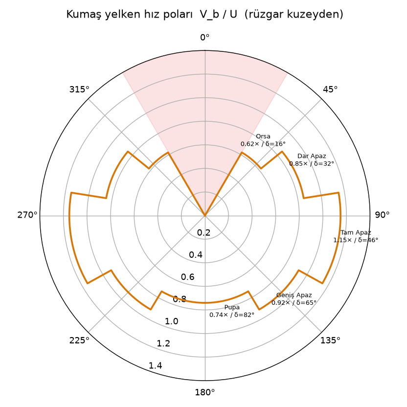
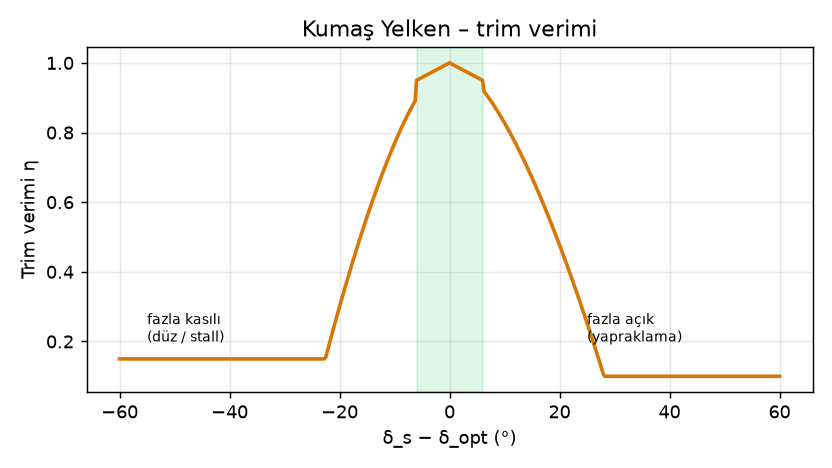
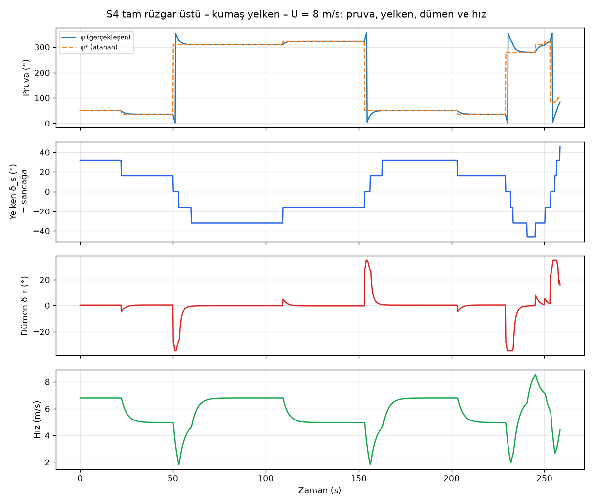
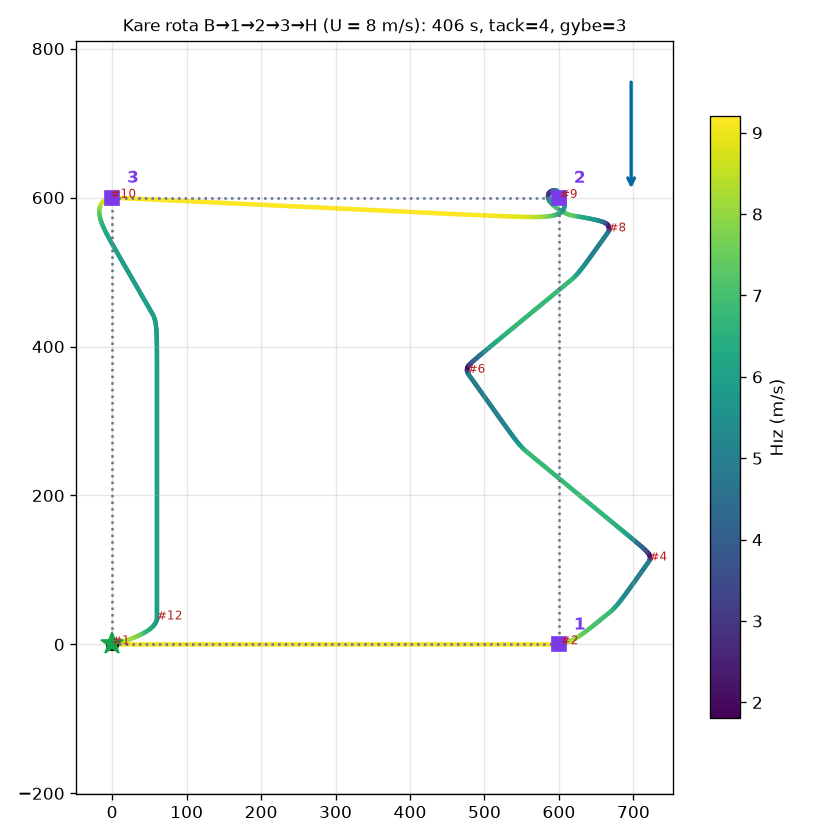
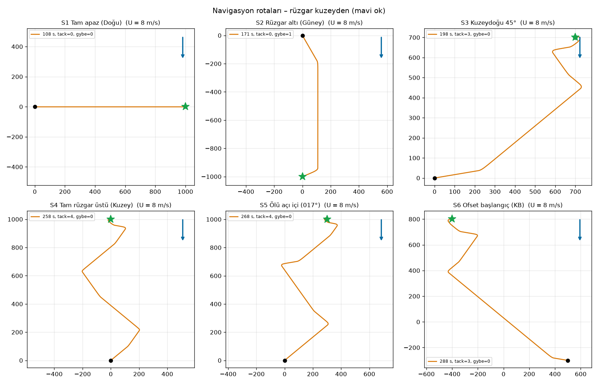
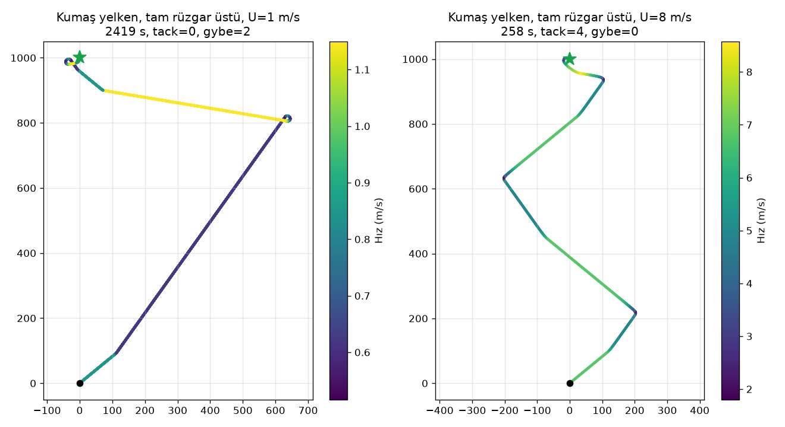
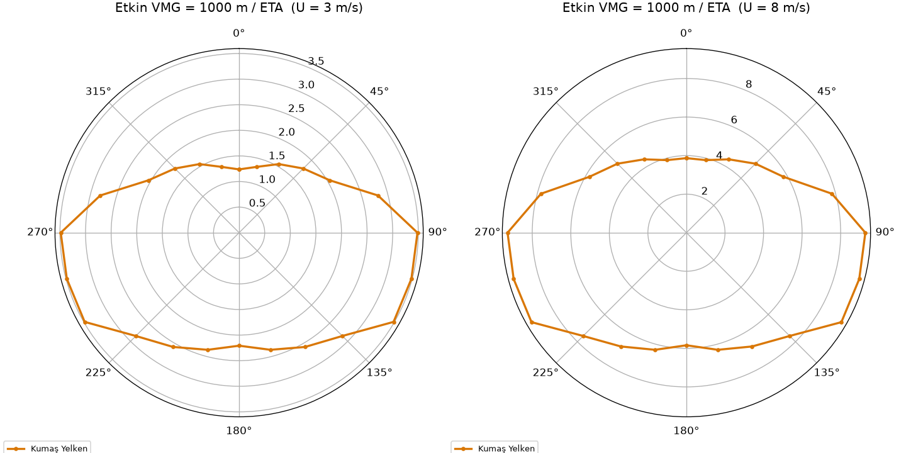

# Saildrone / Yelkenli Katamaran Simülatörü — Kumaş Yelken Modeli: Matematiksel Model, Hedefe Navigasyon ve Test Raporu

**Tarih:** 21 Ekim 2026  **Kapsam:** `saildrone_model.py` (fizik modeli), `navigation.py` (güdüm ve kontrol), `app.py` + `components/nav_player` (arayüz), `tests/`, `analysis/`

---

## 1. Özet

Bu çalışmada simülatör **tek bir yelken modeline — Kumaş Yelken (Cambered / Klasik)** — indirgenmiştir. Model, aynı denklemlerle hem *Serbest Seyir* (kullanıcının yelken, dümen ve pruva açılarını elle verdiği açık çevrim) hem de *Hedefe Navigasyon* (sistemin açıları kendisinin atadığı kapalı çevrim) ekranlarında kullanılır.

| Başlık | Sonuç |
|---|---|
| Yelken modeli | Kumaş yelken: 5 bantlı hız poları + trim verimi + dümen sürüklemesi |
| Serbest seyir dinamiği | Hedef hız → 1. derece ileri (surge) dinamiği → kinematik dönüş + orsaya kaçma → konum |
| Hedefe navigasyon | Kerteriz → ölü açı kontrolü → VMG-optimum pruva → kontra (tack/gybe) kararı → auto-trim yelken açısı → ters-kinematik dümen açısı |
| Rota | Başlangıç → istenen sayıda ara durak → hedef (çokgen, daire, yay rotaları) |
| Birim testleri | **93 / 93 geçti** (`pytest`: model 40 + navigasyon 53) |
| Senaryo matrisi | **24 / 24 hedefe ulaşıldı** (4 rüzgar hızı × 6 başlangıç–hedef çifti) |
| 360° erişilebilirlik | **48 / 48 hedefe ulaşıldı** (1 km yarıçapta 15°'de bir hedef, 3 ve 8 m/s) |
| Ara duraklı rota | Kare rota (4 bacak, 8 m/s) 406 s'de tamamlandı; 4 tack, 3 gybe |

Rüzgar her testte **kuzeyden (000°) eser ve sabittir**; testler arasında yalnızca rüzgar hızı ve başlangıç / hedef konumları değiştirilir.

---

## 2. Koordinatlar, açılar ve işaret kuralları

| Sembol | Anlamı | İşaret / aralık |
|---|---|---|
| $x, y$ | Doğu, Kuzey konumu (m) | — |
| $\psi$ | Pruva açısı (pusula) | 0° = Kuzey, saat yönünde artar, $[0°, 360°)$ |
| $U$ | Rüzgar hızı (m/s) | Kuzeyden eser |
| $\theta$ | Gerçek rüzgar açısı (TWA) | $[0°, 180°]$ |
| $\delta_s$ | Yelken bom açısı (orta hattan) | $+$: bom sancağa, $-$: iskeleye; $\lvert\delta_s\rvert \in [0°, 90°]$ |
| $\delta_r$ | Dümen açısı | $+$: pala sancağa → tekne sancağa döner ($\psi$ artar); $\lvert\delta_r\rvert \le 35°$ |
| $v$ | Teknenin ileri hızı (m/s) | $v \ge 0$ |
| $s$ | Rüzgar altı bordası | $+1$: iskele kontra (yelken sancakta), $-1$: sancak kontra, $0$: ölü açı |

Rüzgar kuzeyden geldiği için gerçek rüzgar açısı ve rüzgar altı bordası doğrudan pruvadan bulunur:

$$\theta(\psi) = \min(\psi,\; 360° - \psi), \qquad s(\psi) = \begin{cases} +1, & 0° < \psi \le 180°,\ \theta > 30° \\ -1, & 180° < \psi < 360°,\ \theta > 30° \\ 0, & \theta \le 30° \ \text{(ölü açı)} \end{cases}$$

---

## 3. Serbest Seyir: Kumaş Yelken Dinamiği (adım adım)

Serbest seyirde kullanıcı üç açıyı verir: **pruva $\psi_0$, yelken bom açısı $\delta_s$ ve dümen açısı $\delta_r$**. Bu üç açının teknenin hızına ve yönelimine etkisi aşağıdaki yedi adımla hesaplanır. Her adım bir öncekinin çıktısını kullanır.

### Adım 1 — Rüzgarın tekneye göre açısı

$\theta = \min(\psi, 360°-\psi)$. $\theta \le 30°$ ise tekne **ölü açıdadır (330°–030°)**: kumaş yelken rüzgarı tutamaz, yapraklar, itki sıfırdır.

### Adım 2 — Seyir bandı: hız oranı ve optimum bom açısı

$\theta$ hangi banda düşerse kumaş yelkenin o banttaki **hız oranı** $\rho = V_b/U$ ve **optimum bom açısı** $\delta_{opt}$ okunur:

| Bant | $\theta$ aralığı | $\delta_{opt}$ | $\rho = V_b/U$ | Yelkenin durumu |
|---|---|---|---|---|
| Ölü açı | $0°$–$30°$ | — | 0 | Yapraklar, itki yok |
| Orsa | $30°$–$50°$ | 16° | 0.62 | Iskota sonuna kadar kasılı |
| Dar apaz | $50°$–$80°$ | 32° | 0.85 | Biraz boşlanmış, tor artar |
| Tam apaz | $80°$–$120°$ | 46° | 1.15 | Tam dolu ve torlu (en hızlı seyir) |
| Geniş apaz | $120°$–$150°$ | 65° | 0.92 | İyice boşlanmış |
| Pupa | $150°$–$180°$ | 82° | 0.74 | Paraşüt gibi dolar, itki sürüklemeden |



### Adım 3 — Yelken trimi: aerodinamik verim $\eta(\delta_s)$

Bomun optimum açıdan sapması $d = \lvert\,\lvert\delta_s\rvert - \delta_{opt}\rvert$ yelkenin ürettiği itkiyi azaltır:

$$\eta(\delta_s) = \begin{cases} 1 - 0.05\,\dfrac{d}{6°}, & d \le 6° \quad \text{(tam trim)}\\[2mm] \max\!\left(0.15,\; 1 - \left(\dfrac{d}{25°}\right)^{1.6}\right), & \lvert\delta_s\rvert < \delta_{opt} \quad \text{(fazla kasılı: yelken düzleşir, akış kopar)}\\[2mm] \max\!\left(0.10,\; 1 - \left(\dfrac{d}{30°}\right)^{1.6}\right), & \lvert\delta_s\rvert > \delta_{opt} \quad \text{(fazla açık: ön kenar yapraklar)} \end{cases}$$

Fazla açık dalın ölçeği (30°) fazla kasılı dalınkinden (25°) büyüktür: kumaş yelken boşlandığında itkiyi kademeli kaybeder, fazla kasıldığında ise akış daha erken kopar. *Auto-Trim* açıkken $\lvert\delta_s\rvert = \delta_{opt}$ alınır ve $\eta = 1$ olur.



### Adım 4 — Dümenin sürükleme etkisi $\kappa(\delta_r)$

Açılan dümen palası suya karşı direnç oluşturur ve hızı düşürür:

$$\kappa(\delta_r) = 1 - 0.22\left(\frac{\lvert\delta_r\rvert}{35°}\right)^2, \qquad \kappa(0) = 1,\ \ \kappa(\pm35°) = 0.78$$

### Adım 5 — Aerodinamik kuvvetin gövdeye iletimi: hız

Yelkenin ürettiği itki ile gövdenin su direnci dengelendiğinde tekne bir **kararlı-durum (hedef) hızına** ulaşır. Kumaş yelken modelinde bu denge hızı polar, trim ve dümen çarpanlarının çarpımıdır:

$$V^* = U\cdot\rho(\theta)\cdot\eta(\delta_s)\cdot\kappa(\delta_r)$$

Tekne bu hıza anında değil, kütlesi nedeniyle gecikmeyle ulaşır. İleri yön (surge) hareket denklemi $m\,\dot v = F_{itki} - F_{direnç}$, denge hızı etrafında doğrusallaştırılınca birinci derece bir sisteme dönüşür:

$$\dot v = \frac{V^* - v}{\tau}, \qquad \tau = 3\ \text{s}$$

Yani gövdeye iletilen **net ileri kuvvet** $F_{net} = m\,(V^*-v)/\tau$'dur: tekne hedef hızından yavaşsa yelken onu hızlandırır, hızlıysa (ör. ölü açıya girdiğinde $V^*=0$) su direnci yavaşlatır. Ayrık zamanda tam çözüm kullanılır (her $\Delta t$ için kararlı):

$$v_{k+1} = V^*_k + (v_k - V^*_k)\,e^{-\Delta t/\tau}$$

### Adım 6 — Dümen etkisi ve dönme momenti: yönelim

Dümen palası, akışa açılı durduğunda bir yan kuvvet üretir; bu kuvvet gövdenin dönme merkezine olan uzaklığı ($L$) kadar bir kolla **dönme momenti** oluşturur. Momentin etkisi, yan kaymanın ihmal edildiği kinematik (bisiklet) modeliyle doğrudan dönüş hızına çevrilir. Buna ek olarak, kumaş yelkenin basınç merkezi gövdenin yanal direnç merkezinin gerisinde kaldığından tekne kendiliğinden rüzgara doğru döner (**orsaya kaçma**, weather helm):

$$\dot\psi\ [°/\text{s}] = \underbrace{\frac{v}{L}\,\sin\delta_r\cdot\frac{180}{\pi}}_{\text{dümen momenti}} \;-\; \underbrace{s(\psi)\,\omega_{wh}}_{\text{yelken momenti}}, \qquad L = 4.6\ \text{m},\ \ \omega_{wh} = 0.35\ °/\text{s}$$

* Dümen etkisi **hızla orantılıdır**: $v \le 0.2$ m/s iken $\dot\psi = 0$ (dümen dümen tutmaz).
* Sabit dümende dönüş yarıçapı $R = L/\sin\delta_r$ (tam dümende $R = 8.0$ m).
* Orsaya kaçma rüzgar altı bordasına bağlıdır: iskele kontrada ($s=+1$) pruva azalır, sancak kontrada ($s=-1$) artar — her iki durumda da tekne rüzgara döner.

### Adım 7 — Konum

$$\dot x = v\sin\psi, \qquad \dot y = v\cos\psi$$

### Sayısal çözüm ($\Delta t = 0.25$ s)

Her adımda sırasıyla: (1) $\theta_k$, $\rho$, $\delta_{opt}$; (2) $\eta$, $\kappa$ → $V^*_k$; (3) $v_{k+1}$; (4) $\psi_{k+1} = \psi_k + \dot\psi(v_{k+1}, \delta_r, \psi_k)\,\Delta t$; (5) $x, y \mathrel{+}= v_{k+1}(\sin\psi_{k+1}, \cos\psi_{k+1})\,\Delta t$. Auto-Trim açıksa (2)'de bom açısı her adımda yeni $\theta$'ya göre güncellenir.

### Sayısal örnek (U = 8 m/s, $\psi$ = 090°, tam apaz)

| Girdi | $\eta$ | $\kappa$ | $V^*$ (m/s) | $\dot\psi$ (°/s) | Yorum |
|---|---|---|---|---|---|
| $\delta_s = 46°$, $\delta_r = 0°$ | 1.00 | 1.00 | **9.20** | −0.35 | Tam trim; yalnızca orsaya kaçma |
| $\delta_s = 30°$, $\delta_r = 0°$ | 0.51 | 1.00 | 4.70 | −0.35 | 16° fazla kasılı: itki yarıya düşer |
| $\delta_s = 60°$, $\delta_r = 0°$ | 0.71 | 1.00 | 6.48 | −0.35 | 14° fazla açık: yapraklama |
| $\delta_s = 46°$, $\delta_r = +10°$ | 1.00 | 0.98 | 9.03 | +19.2 | $R$ = 26.5 m sancağa dönüş |
| $\delta_s = 46°$, $\delta_r = +20°$ | 1.00 | 0.93 | 8.54 | +36.0 | $R$ = 13.4 m |
| $\delta_s = 46°$, $\delta_r = +35°$ | 1.00 | 0.78 | 7.18 | +50.9 | Tam dümen, $R$ = 8.0 m |

---

## 4. Hedefe Navigasyon: Kumaş Yelkenle Hedefe Gidiş (adım adım)

Navigasyonda üç açıyı artık **sistem atar**: hedef pruva $\psi^*$, yelken açısı $\delta_s$ ve dümen açısı $\delta_r$. Rota, başlangıç (B), istenen sayıda ara durak (1, 2, …) ve hedeften (H) oluşan bacaklara bölünür; **her bacakta aynı algoritma** çalışır ve tekne bir sonraki bacağa önceki bacağın son pruvası ve hızıyla girer. Aşağıdaki adımlar her güdüm periyodunda (1 s) tekrarlanır.

### Adım 1 — Hedefin kerterizi

Teknenin $(x, y)$ konumundan bacağın hedef noktasına $(x_h, y_h)$ pusula açısı:

$$\beta = \operatorname{atan2}(x_h - x,\; y_h - y) \quad (0° = \text{Kuzey})$$

### Adım 2 — Ölü açı kontrolü

$\theta(\beta) \le 30°$ ise hedef **ölü açının içindedir**: doğrudan hedefe dönülürse yelken yapraklar ve tekne durur. Bu durumda tekne hedefe zikzakla (kontra değiştirerek) gider. Kontrol, bir sonraki adımdaki VMG aramasında ölü açıya **5° güvenlik payı** bırakılarak otomatik olarak sağlanır (aranan pruvalar $\theta \ge 35°$).

### Adım 3 — Optimum pruva: VMG (hedefe doğru hız bileşeni)

Tekne hedefe doğru değil, **hedefe en hızlı yaklaştıran** pruvaya yönlendirilir. Bir $\psi$ pruvasının hedefe yaklaşma hızı:

$$\text{VMG}(\psi) = \underbrace{U\,\rho(\theta(\psi))}_{\text{teknenin hızı}}\cdot\cos(\psi - \beta)$$

Her kontra için en iyi pruva ayrı aranır ($s=+1$: $\psi = \theta$, $s=-1$: $\psi = 360° - \theta$):

$$\psi^*_{s} = \arg\max_{\theta \,\ge\, 35°} \ \text{VMG}(\psi_s(\theta))$$

**Rüzgar üstü hedef örneği ($\beta = 0°$, hedef tam kuzeyde):**

| Aday $\theta$ | Bant | $\rho$ | $\text{VMG}/U = \rho\cos\theta$ |
|---|---|---|---|
| 35.5° | Orsa | 0.62 | 0.505 |
| 40.0° | Orsa | 0.62 | 0.475 |
| **50.5°** | **Dar apaz** | **0.85** | **0.541 ← en iyi** |
| 60.0° | Dar apaz | 0.85 | 0.425 |
| 80.5° | Tam apaz | 1.15 | 0.190 |

Kumaş yelken orsada (0.62) yavaş olduğundan, rüzgara en dik açıyla (35.5°) gitmek yerine **50.5°'de dar apaz** gitmek hedefe daha hızlı yaklaştırır: $\psi^* = 050.5°$ (iskele kontra) veya $309.5°$ (sancak kontra). Benzer şekilde **rüzgar altı hedefte** ($\beta = 180°$) en iyi açı $\theta = 150°$'dir ($\text{VMG}/U = 0.92\cos30° = 0.797$); tam pupa ($0.74$) daha yavaştır, bu yüzden rüzgar altına da zikzakla (gybe ile) gidilir.

### Adım 4 — Kontra seçimi ve değiştirme kuralı

Tekne mevcut kontrasında kalır. Diğer kontranın VMG'si daha büyükse ve aşağıdakilerden biri sağlanırsa kontra değiştirilir:

1. **Hedef geride kaldı:** mevcut kontranın VMG'si $\le 0$.
2. **Layline:** diğer kontranın optimum pruvası $\psi^*_{-s}$ artık hedefi "tutuyor" — tekne o pruvaya dönerse hedefe tek bacakta ulaşır.
3. **Koridor:** tekne başlangıç–hedef hattından $W = 0.2\,D$ (50–1000 m arası) kadar uzaklaştı ve hâlâ uzaklaşıyor.

Gereksiz manevrayı önlemek için iki kontra değişimi arasında en az 10 s geçmelidir.

### Adım 5 — Manevra türü: tack mı, gybe mi?

Yeni pruvaya en kısa dönüş rüzgarın içinden (ölü açıdan) geçiyorsa bu bir **tack**'tir. Ölü açıda $V^* = 0$ olduğundan tekne yalnızca taşıdığı hızla döner; hız $v_0 e^{-t/\tau}$ ile söner. Tam dümenle dönülebilecek toplam açı:

$$\Theta_{max} = \int_0^\infty \frac{v_0\,e^{-t/\tau}}{L}\,\sin\delta_{max}\,dt = \frac{v_0\,\tau\,\sin\delta_{max}}{L}$$

Ölü açıyı ve 5° payı geçmek için gereken açı $2\cdot30° + 5° = 65°$'dir:

* Fiziksel alt sınır ($\Theta_{max} \ge 65°$): $v_0 \ge 3.03$ m/s.
* Navigasyonun karar ölçütü 1.3 güvenlik katsayısı içerir ($\Theta_{max} \ge 84.5°$): $v_0 \ge 3.94$ m/s. Bu sağlansa bile karar, manevranın ileri simülasyonuyla kesinleştirilir.

Kumaş yelkenle bu, orsadan tack için yaklaşık **U ≥ 6.5 m/s** demektir (açık çevrim simülasyonu: 6.5 m/s'de tack başlangıç hızı 3.14 m/s). Tack mümkün değilse tekne **rüzgar altından ~290° dönerek (gybe)** kontra değiştirir; bu durumda değişim, manevra sonrasında hedefin hâlâ tutulabildiği ileri simülasyonla doğrulanınca yapılır.

### Adım 6 — Yelken açısının atanması (auto-trim)

Yelken her adımda anlık rüzgar açısına göre optimum açıya ve **rüzgar altı bordasına** açılır:

$$\delta_s = s(\psi)\cdot\delta_{opt}(\theta(\psi)) \;\Rightarrow\; \eta = 1$$

Örn. $\psi = 050.5°$ → $+32°$ (bom sancakta), $\psi = 309.5°$ → $-32°$ (bom iskelede). Tack sırasında $\theta \le 30°$ olduğundan $\delta_s = 0$ (yelken yapraklar), tack bitince bom karşı bordaya geçer.

### Adım 7 — Dümen açısının atanması (ters kinematik kontrolcü)

Pruva hatası $e = \psi^* - \psi$ (seçilen dönüş yönüne göre işaretli) bir istenen dönüş hızına, bu da Adım 6'daki dönüş denkleminin tersiyle dümen açısına çevrilir:

$$r^* = \operatorname{sat}\!\big(k\,e,\ \pm30°/\text{s}\big) + s(\psi)\,\omega_{wh}, \qquad \delta_r = \operatorname{sat}\!\left(\arcsin\frac{r^*\,L}{v},\ \pm35°\right), \qquad k = 0.5\ \text{s}^{-1}$$

* Doymasız bölgede kapalı çevrim $\dot e = -k\,e$ olur: pruva hatası 2 s zaman sabitiyle, **hızdan bağımsız** olarak söner.
* $s\,\omega_{wh}$ terimi orsaya kaçmayı önceden karşılar; bu yüzden düz seyirde dümen sıfır değil, küçük bir sabit açıdır: $\delta_{r,ss} = \arcsin(s\,\omega_{wh} L / v)$. Örn. $v = 6.8$ m/s'de $\delta_{r,ss} = +0.24°$ (iskele kontra).
* Tack/gybe sırasında hata büyük olduğundan dümen ±35° sınırına dayanır.

### Adım 8 — Varış ve başarısızlık

* **Ara durak / hedefe varış:** $\lVert p - p_h \rVert \le r_{varış}$ (varsayılan 10 m). Ara durakta tekne bir sonraki bacağın en iyi VMG kontrasını seçer.
* **Başarısızlık:** süre sınırı (tüm rota için, varsayılan 7200 s) aşılırsa veya tekne ölü açıda $v < 0.05$ m/s ile 20 s kalırsa.

### Akış özeti

```
Her güdüm periyodunda (1 s):
  β  ← hedef kerterizi                                   (Adım 1)
  ψ*₊, ψ*₋ ← her kontra için max VMG, θ ≥ 35°           (Adım 2–3)
  kontra değişsin mi? (VMG ≤ 0 | layline | koridor)      (Adım 4)
  dönüş yönü ← tack mümkünse rüzgar içinden, değilse gybe (Adım 5)
Her entegrasyon adımında (0.25 s):
  δs ← s(ψ)·δopt(θ)                                      (Adım 6)
  δr ← sat(asin(r*·L / v), ±35°)                         (Adım 7)
  v, ψ, x, y ← Bölüm 3 denklemleri
  varış / başarısızlık kontrolü                          (Adım 8)
```

### 4.1 Örnek: tam rüzgar üstü hedef (B = (0, 0) → H = (0, 1000) m, U = 8 m/s)

Hedef ölü açının tam ortasında ($\beta = 0°$). Tekne 50.5°'de dar apazla başlar, hedef yaklaştıkça layline'a göre 35.5° orsaya çıkar ve 4 tack ile 258 s'de hedefe ulaşır. Arayüzdeki **Açı Takip Tablosu**'nun bu test için ürettiği kayıt:

| # | Zaman (s) | Bacak | Olay | ψ* (°) | TWA (°) | Seyir | Kontra | δs (°) | δr manevra (°) | δr seyir (°) | Ort. hız (m/s) |
|---|---|---|---|---|---|---|---|---|---|---|---|
| 1 | 0–22 | B→H | Başlangıç | 50.5 | 50.5 | Dar Apaz | İskele | +32 | +0.0 | +0.2 | 6.80 |
| 2 | 22–50 | B→H | Rota düzeltme | 35.5 | 35.5 | Orsa | İskele | +16 | −4.8 | +0.2 | 5.16 |
| 3 | 50–109 | B→H | Tack | 309.5 | 50.5 | Dar Apaz | Sancak | −32 | −35.0 | −0.4 | 6.14 |
| 4 | 109–153 | B→H | Rota düzeltme | 324.5 | 35.5 | Orsa | Sancak | −16 | +4.8 | −0.2 | 5.09 |
| 5 | 153–203 | B→H | Tack | 50.5 | 50.5 | Dar Apaz | İskele | +32 | +35.0 | +0.4 | 6.02 |
| 6 | 203–229 | B→H | Rota düzeltme | 35.5 | 35.5 | Orsa | İskele | +16 | −4.8 | +0.1 | 5.18 |
| 7 | 229–245 | B→H | Tack | 279.5 | 80.5 | Tam Apaz | Sancak | −46 | −35.0 | −0.7 | 5.32 |
| 8 | 245–258 | B→H | Rota düzeltme | 309.5 | 50.5 | Dar Apaz | Sancak | −32 | +7.9 | +16.7 | 5.85 |

*δr manevra*: pruva yeni ψ*'a oturana kadarki en büyük dümen açısı; *δr seyir*: manevra sonrası ortalama dümen açısı. Tack satırlarında dümen ±35°'ye dayanır, yelken işaret değiştirir (bom karşı bordaya geçer); düz seyirde dümen yalnızca orsaya kaçmayı karşılayan ≈ ±0.2°'dir. Son satır, hedefin hemen yakınındaki son yaklaşma manevrasıdır.



### 4.2 Örnek: ara duraklı kare rota (B → 1 → 2 → 3 → H, 600 m, U = 8 m/s)

| # | Zaman (s) | Bacak | Olay | ψ* (°) | TWA (°) | Seyir | Kontra | δs (°) | δr manevra (°) | δr seyir (°) | Ort. hız (m/s) |
|---|---|---|---|---|---|---|---|---|---|---|---|
| 1 | 0–64 | B→1 | Başlangıç | 90.0 | 90.0 | Tam Apaz | İskele | +46 | +0.0 | +0.2 | 9.20 |
| 2 | 64–75 | 1→2 | Ara durak 1 ✓ | 50.5 | 50.5 | Dar Apaz | İskele | +32 | −9.7 | −0.2 | 7.56 |
| 3 | 76–91 | 1→2 | Rota düzeltme | 35.5 | 35.5 | Orsa | İskele | +16 | −4.8 | +0.0 | 5.33 |
| 4 | 92–130 | 1→2 | Tack | 309.5 | 50.5 | Dar Apaz | Sancak | −32 | −35.0 | −0.4 | 5.80 |
| 5 | 130–155 | 1→2 | Rota düzeltme | 324.5 | 35.5 | Orsa | Sancak | −16 | +4.8 | −0.1 | 5.19 |
| 6 | 156–189 | 1→2 | Tack | 50.5 | 50.5 | Dar Apaz | İskele | +32 | +35.0 | +0.5 | 5.65 |
| 7 | 190–204 | 1→2 | Rota düzeltme | 35.5 | 35.5 | Orsa | İskele | +16 | −4.8 | −0.0 | 5.34 |
| 8 | 204–228 | 1→2 | Tack | 279.5 | 80.5 | Tam Apaz | Sancak | −46 | −35.0 | +12.1 | 4.98 |
| 9 | 229–299 | 2→3 | Ara durak 2 ✓ | 270.0 | 90.0 | Tam Apaz | Sancak | −46 | +28.3 | −0.1 | 8.83 |
| 10 | 299–328 | 3→H | Ara durak 3 ✓ | 150.0 | 150.0 | Geniş Apaz | İskele | +65 | −16.4 | +0.1 | 6.40 |
| 11 | 328–397 | 3→H | Rota düzeltme | 180.0 | 180.0 | Pupa | İskele | +82 | +12.0 | +0.2 | 5.92 |
| 12 | 397–406 | 3→H | Gybe | 240.0 | 120.0 | Tam Apaz | Sancak | −46 | +24.3 | +1.9 | 7.08 |

Doğuya giden ilk bacak tam apazdır (9.2 m/s, düz). Kuzeye giden ikinci bacak rüzgar üstüdür ve zikzakla (3 tack) geçilir. Batıya giden üçüncü bacak yine tam apazdır (bom bu kez iskelede, −46°). Güneye dönüşte tekne 150° geniş apaz ve pupa ile iner, hedefe gybe ile oturur.



---

## 5. Arayüz: Hedefe Navigasyon ekranı

Serbest Seyir ekranındaki kullanım kolaylığı Hedefe Navigasyon ekranına taşınmıştır:

| Özellik | Açıklama |
|---|---|
| Kaydırıcı + kutucuk | Rüzgar hızı, başlangıç/hedef X–Y, varış yarıçapı, süre sınırı ve (isteğe bağlı) başlangıç pruvası hem kaydırıcıyla hem klavyeyle girilir; ikisi senkron kalır. |
| Sürükle-bırak | Haritadaki başlangıç (B), hedef (H) ve ara duraklar fareyle sürüklenir; bırakınca koordinat kutucukları güncellenir ve rota yeniden hesaplanır. |
| Ara duraklar | Haritada çift tıklama veya "➕ Ara durak ekle" ile eklenir, sağ tık veya "➖" ile silinir, tablodan elle düzenlenir. Hazır şablonlar: kare, üçgen, altıgen, daire (12 nokta), yay. |
| Açı Takip Tablosu | Her yeni testte sıfırlanır; oynatma ilerledikçe rota bacaklarında sistemin atadığı pruva ψ*, TWA/seyir tipi, yelken δs ve dümen δr (manevra + seyir) satır satır eklenir, etkin satır vurgulanır. CSV olarak indirilebilir. |
| Hızlandırılmış oynatma | Rota baştan sona ×1–×200 hızla oynatılır (varsayılan: görev ≈ 20–25 s'de); duraklat, baştan oynat ve zaman çubuğuyla istenen ana gidilebilir. |
| Canlı göstergeler | Zaman, anlık hız (m/s, kts), pruva ψ ve atanan ψ*, yelken δs, dümen δr, seyir tipi/TWA, aktif bacak ve kalan mesafe oynatma boyunca canlı akar. |
| Katamaran animasyonu | Haritadaki tekne ve "yakın görünüm" penceresinde yelkenin (mavi) ve dümen palalarının (kırmızı) anlık açıları, ölü açı dilimi ve atanan pruva ile birlikte dinamik olarak çizilir. |

Uygulama: `streamlit run app.py`. Harita bileşeni `components/nav_player/index.html` dosyasındadır (dış bağımlılık yoktur).

---

## 6. Testler ve sonuçlar

### 6.1 Birim testleri (93 / 93 ✔)

`tests/test_model.py` — ölü açıda itki sıfır; iskele/sancak simetrisi; kontra adlandırması; trim verimi tepe değeri ve sınırları; dümen cezası; düz seyirde yol = hız × süre; telemetri hızı = dinamik hız; pozitif dümen → sancağa dönüş; orsaya kaçma yönü; ölü açıda başlayan tekne hareketsiz; surge yakınsaması; auto-trim'in dönüş boyunca yeniden trim yapması.

`tests/test_navigation.py` — 24 senaryonun tamamı; dümen sınırı ve ölü açıda geçen sürenin < %5 olması; rüzgar üstünde tack gerekliliği; hafif rüzgarda gybe; ölü açıda başlangıcın başarısızlık olarak raporlanması; sıfır mesafe; süre sınırı; 10 km menzil; 12 yönde erişilebilirlik; tack fizibilitesi; layline geometrisi; **ara duraklı rotada tüm durakların ziyareti; rota süre sınırı; yelken açısının rüzgar altı bordasında olması; açı takip tablosunun tack ve ara durakları kaydetmesi.**

### 6.2 Senaryo matrisi (24 / 24 ✔)

S1 (0,0)→(1000,0) tam apaz · S2 (0,0)→(0,−1000) tam rüzgar altı · S3 (0,0)→(700,700) · S4 (0,0)→(0,1000) tam rüzgar üstü · S5 (0,0)→(300,1000) ölü açı içinde (017°) · S6 (500,−300)→(−400,800).

| U (m/s) | S1 | S2 | S3 | S4 | S5 | S6 |
|---|---|---|---|---|---|---|
| 1 | ✔ 861 s | ✔ 1357 s | ✔ 1668 s | ✔ 2419 s | ✔ 2312 s | ✔ 2419 s |
| 3 | ✔ 287 s | ✔ 453 s | ✔ 559 s | ✔ 808 s | ✔ 772 s | ✔ 809 s |
| 8 | ✔ 108 s | ✔ 171 s | ✔ 198 s | ✔ 258 s | ✔ 268 s | ✔ 288 s |
| 15 | ✔ 58 s | ✔ 92 s | ✔ 113 s | ✔ 163 s | ✔ 144 s | ✔ 160 s |

* **Tam apaz en hızlı yöndür**; aynı mesafe için tam rüzgar üstü ≈ 2.4×, tam rüzgar altı ≈ 1.6× daha uzun sürer.
* 1 ve 3 m/s'de tekne hızı tack eşiğinin altında kaldığından kontra değişimleri gybe ile yapılır ve görev yine tamamlanır.
* Tam tablo (yol, rota verimi, tack/gybe sayıları): [docs/results/scenario_matrix.md](docs/results/scenario_matrix.md).





### 6.3 360° erişilebilirlik (48 / 48 ✔)

1 km yarıçaplı çember üzerinde 15°'de bir 24 hedef, 3 ve 8 m/s. Grafik "etkin VMG = 1000 m / varış süresi" değerini gösterir: ölü açı yönündeki hedefler (000°, 015°, 345°) en yavaş, 090°–120° ve 240°–270° (tam apaz) en hızlıdır. Tablo: [docs/results/reachability.md](docs/results/reachability.md).



### 6.4 Uç durumlar (U = 8 m/s, aksi belirtilmedikçe)

| Durum | Ulaştı | Süre (s) | Tack | Gybe | Sonuç |
|---|---|---|---|---|---|
| Başlangıç pruvası ölü açıda (000°), hedef Doğu 1 km | ✘ | 20 | 0 | 0 | Ölü açıda takıldı — hız sıfır, dümen etkisiz |
| Başlangıç pruvası ölü açı sınırında (032°), hedef Kuzey 1 km | ✔ | 261 | 4 | 0 | — |
| Başlangıç pruvası ters yönde (180°), hedef Kuzey 1 km | ✔ | 268 | 4 | 0 | — |
| Tack yasak, varış yarıçapı 10 m, Kuzey 1 km | ✘ | 7200 | 0 | 435 | Süre sınırı (hedef çevresinde döngü) |
| Tack yasak, varış yarıçapı 30 m, Kuzey 1 km | ✔ | 308 | 0 | 2 | — |
| Hafif rüzgar 2 m/s (tack fiziksel olarak imkânsız), Kuzey 1 km | ✔ | 1209 | 0 | 2 | — |
| Hedef başlangıçta (mesafe 0) | ✔ | 0 | 0 | 0 | — |
| Uzun menzil: Kuzey 10 km, 5 m/s | ✔ | 4485 | 2 | 3 | — |
| Kısa süre limiti: Kuzey 1 km, 3 m/s, 300 s | ✘ | 300 | 0 | 0 | Süre sınırı |

### 6.5 Tack yapılamıyorsa: varış yarıçapı duyarlılığı (Kuzey 1 km)

| Varış yarıçapı (m) | U=3 | U=5 | U=8 | U=12 | U=15 |
|---|---|---|---|---|---|
| *Dönüş çapı 2R (m)* | *16* | *16* | *19* | *28* | *36* |
| 10 | ✔ 808 s | ✔ 885 s | ✘ | ✘ | ✘ |
| 20 | ✔ 803 s | ✔ 484 s | ✔ 310 s | ✘ | ✘ |
| 30 | ✔ 768 s | ✔ 481 s | ✔ 308 s | ✔ 232 s | ✔ 289 s |
| 40 | ✔ 758 s | ✔ 456 s | ✔ 291 s | ✔ 214 s | ✔ 177 s |

Hedefe rüzgar altından dönüşle yaklaşılıyorsa varış yarıçapı dönüş çapı mertebesinde olmalıdır; aksi halde manevra tekneyi hedefin rüzgar altına iter ve hedef çevresinde döngü oluşur. Normal modda (tack serbest) bu durum yalnızca tekne hızı tack eşiğinin altındayken oluşur; o hızlarda $R \approx 8$ m olduğundan varsayılan 10 m yeterlidir.

---

## 7. Sonuç

Kumaş yelken modeli ve navigasyon kontrolcüsüyle tekne, test edilen 72 başlangıç–hedef–rüzgar kombinasyonunun (24 senaryo + 48 erişilebilirlik) tamamında ve ara duraklı rotalarda hedefe ulaşmıştır. Hedef ölü açının içinde olsa bile sistem, VMG-optimum pruvayı (rüzgar üstünde 50.5°/35.5°, rüzgar altında 150°) seçip tack veya gybe ile zikzak yapar; her an yelkeni rüzgar altı bordasında optimum açıya açar ve dümeni ters-kinematik kontrolcüyle ±35° sınırında tutar.

Ulaşılamayan durumlar: (1) başlangıç pruvası ölü açıda ve tekne durgunsa, (2) süre sınırı mesafe/etkin VMG'den kısaysa, (3) tack yapılamıyor ve varış yarıçapı dönüş çapından küçükse.

---

## 8. Model sınırlamaları

| Sınırlama | Etkisi | Öneri |
|---|---|---|
| Parçalı sabit polar | VMG-optimum pruvalar bant kenarlarına (35.5°, 50.5°, 80.5°, 150°) düşer | Poları $\theta$'ya göre sürekli (spline) yapmak |
| $V_b \propto U$ (doygunluk yok) | Kuvvetli rüzgarda gerçekçi olmayan hızlar | Rüzgarla doyuran polar, reef |
| Yan kayma (leeway), akıntı, dalga yok | Rota suya göredir | Leeway açısı ve akıntı vektörü |
| Yaw ataleti yok (kinematik dönüş) | Manevralar gerçekte daha yavaş | $I_z\dot r = N_\delta\,\delta_r - N_r\,r$ |
| Ölü açıda durgun tekne kurtulamaz | Uç durum 1 | Rüzgarla sürüklenme / backing modeli |
| $\tau = 3$ s varsayımdır | Tack eşiğini belirler ($v_{min} \propto 1/\tau$) | Gerçek tekne verisiyle tanımlama |

---

## 9. Yeniden üretme

```bash
pip install -r requirements.txt pytest
```
```bash
python -m pytest -q
```
```bash
python analysis/run_experiments.py
```
```bash
streamlit run app.py
```

Grafikler `docs/figures/`, tablolar `docs/results/` altına yeniden yazılır (açı takip tabloları: `angle_log_S4_U8.md`, `angle_log_square_U8.md`).

---

## Ek A — Önceki sürümde düzeltilen hatalar (özet)

Kanıtlar: [docs/results/legacy_bug_evidence.md](docs/results/legacy_bug_evidence.md) (`python analysis/legacy_bug_evidence.py`).

| # | Hata | Düzeltme |
|---|---|---|
| H1 | Kontra adları ters (doğuya giden teknede "Sancak Kontra") | Ad, rüzgarın geldiği bordadan üretiliyor |
| H2 | İskele/sancak sınır asimetrisi (aynı TWA farklı bant) | Önce $\theta$ hesaplanıp tek bant tablosu kullanılıyor |
| H3 | Ekrandaki hız ile simülasyondaki hız farklı formüllerden (≈ %47'ye varan fark) | Tek `trim_efficiency()` fonksiyonu |
| H4 | Auto-trim dönüşte yeniden trim yapmıyordu | Bom her adımda optimuma geliyor |
| H5 | Orsaya kaçma, dümen 2°'nin altındayken açılıp kapanıyordu (süreksiz) | Moment her zaman var, dümen karşılıyor |
| H6 | İleri yön ataleti yoktu: ölü açıya giren tekne kilitleniyordu, tack imkânsızdı | Surge dinamiği ($\tau$ = 3 s) |
| H7 | Yörünge etiketi son pruvayı başlangıç hızıyla gösteriyordu | "Son pruva / ortalama hız" |
| H8 | Fizik kodu arayüzle iç içeydi (test edilemez) | `saildrone_model.py`, `navigation.py` ayrıldı |
