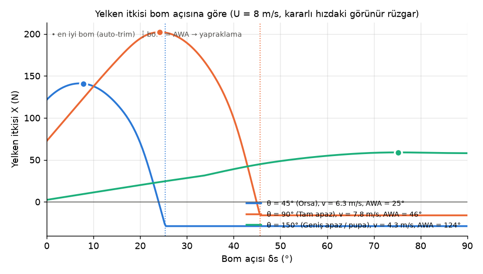
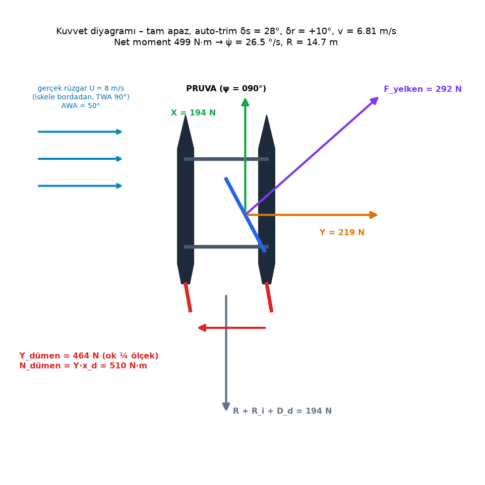

# Otonom Yelkenli Katamaran Simülatörü — Kuvvet Tabanlı (VPP) Model, Hedefe Navigasyon, Düz Rota (PID) ve Test Raporu

**Tarih:** 22 Ekim 2026  **Kapsam:** `saildrone_model.py` (fizik modeli), `navigation.py` (güdüm ve kontrol), `line_follow.py` (düz rota PID), `app.py` + `components/` (arayüz), `tests/`, `analysis/`

---

## 1. Özet

Simülatör, **mürettebatsız, otonom bir yelkenli katamaranı** (≈ 50 kg; ölçüleri henüz belli değil) A noktasından B noktasına götürmek için kullanılır. Bu sürümde üç ekranın (Serbest Seyir, Hedefe Navigasyon, Düz Rota PID) **tamamı aynı kuvvet tabanlı fizik modelini** kullanır: teknenin hızı ve en iyi bom açısı, görünür rüzgarda yelkenin ürettiği kuvvetlerden ve suyun direncinden hesaplanır (VPP – Velocity Prediction Program yaklaşımı). Önceki sürümdeki hazır hız tablosu (polar) ve kalibrasyon sabitleri kaldırılmıştır.

Tekne ölçüleri henüz belli olmadığından model **boyuttan bağımsız** kurulmuştur: bütün kuvvetler hızın karesiyle ölçeklendiği için kararlı hız / rüzgar oranı V/U, en iyi bom açısı ve yan kayma açısı **rüzgar hızından, tekne boyutundan ve kütleden bağımsızdır**. Kütle yalnızca ivmelenmeyi ve süzülmeyi (tack), gövde boyu yalnızca dönüşü etkiler. Boyuta bağlı fizik (devrilme sınırı, dalga direnci tepesi) bir sonraki aşama olan boyutlandırma için modelde hazırdır ama varsayılan olarak kapalıdır. Testler de tek bir tekneye bağlı değildir: aynı testler geometrik olarak küçültülmüş / büyütülmüş ve farklı kütleli beş teknede geçer.

| Başlık | Sonuç |
|---|---|
| Fizik modeli | Görünür rüzgar → kumaş yelken C_L(α), C_D(α) → itki X ve yan kuvvet Y → gövde, yan kayma ve dümen direnci → ileri hız; Nomoto dönüş ataleti, dümen servosu, dümen stall'u, orsaya kaçma, yan kayma (Bölüm 3) |
| Kararlı hız (polar) | Kuvvet dengesinin çözümü; en yüksek V/U = 0.99 (TWA ≈ 80°), orsada 0.72 (40°), pupada 0.46 (180°) |
| Boyuttan bağımsızlık | V/U, bom ve yan kayma açısı 2–20 m/s rüzgarda, 0.5×–3× geometrik ölçekte ve 25–200 kg kütlede aynı (Bölüm 3.10) |
| Hedefe navigasyon | Polar zarfıyla en kısa süreli rota (düz / iki bacak), VMG + layline ile tack/gybe, süzülme mesafesine dayalı tack kararı, son yaklaşmada oransal seyrüsefer (Bölüm 5) |
| Düz rota (PID) | Kaskad PID (sapma → hedef pruva → dümen), ileri besleme (orsaya kaçma, yan kayma), hıza göre kazanç ölçekleme (Bölüm 6) |
| Birim testleri | **345 / 345 geçti** (`pytest`: model 162, navigasyon 82, düz rota 101) |
| Senaryo matrisi | **30 / 30 hedefe ulaşıldı** (1–20 m/s × 6 başlangıç–hedef çifti) |
| 360° erişilebilirlik | **72 / 72 hedefe ulaşıldı** (1 km yarıçapta 15°'de bir hedef, 3, 8 ve 15 m/s) |
| Tekne boyutu / kütle | 5 tekne (×0.75, referans, ×2 ölçek; 25 kg, 150 kg) × 5 rüzgar × 12 yön = **300 / 300** hedefe ulaşıldı; düz rota 5 teknede de < 0.25 m RMS sapma |

Rüzgar her testte **kuzeyden (000°) eser ve sabittir**; testler arasında yalnızca rüzgar hızı ve başlangıç / hedef konumları değişir.

### 1.1 Bu sürümde düzeltilen fizik hataları (özet)

Kullanıcının "rüzgar yönü ile yelken açısı aynıyken tekne gidiyor" gözlemine benzer hataların taranması sonucunda aşağıdakiler bulunup düzeltilmiştir (ayrıntı: Ek A, H11–H22):

* **Yapraklama gerçek rüzgara göre değerlendiriliyordu.** Tekne hızlandıkça görünür rüzgar pruvaya kayar; artık hücum açısı görünür rüzgarla hesaplanır.
* **Bom orta hattayken tam apazda tekne ilerliyordu.** Rüzgara dik duran yelken yalnızca yana iter; artık itki sıfırdır.
* **Kuvvet katsayıları fiziksel sınırları aşıyordu** (rüzgar altında C_N > 1.5). Hız artık kuvvetlerden hesaplandığı için katsayılar kumaş yelkenin ölçülebilir aralığındadır.
* **Orsaya kaçma her seyirde sabitti** (0.35 °/s); artık yelkenin yan kuvvetinden hesaplanır.
* **Yan kayma yalnızca düz rota ekranındaydı**; artık üç ekranda aynıdır.
* **Dümen stall'u dönüşü sınırlamıyordu** (35° dümen 20°'den daha çok döndürüyordu); artık stall'dan sonra dönüş artmaz, pala frenler.
* **Navigasyon anlık VMG'yi kovalayarak sarmal (takip eğrisi) çiziyordu**; artık polar zarfına göre düz gidilir ya da iki bacak seçilir.
* **Hızlı teknede hedef çevresinde dönme** ve **rüzgara karşı süzülürken hedefin önünde durma** düzeltildi.

---

## 2. Koordinatlar, açılar ve işaret kuralları

| Sembol | Anlamı | İşaret / aralık |
|---|---|---|
| $x, y$ | Doğu, Kuzey konumu (m) | — |
| $\psi$ | Pruva açısı (pusula) | 0° = Kuzey, saat yönünde artar, $[0°, 360°)$ |
| $U$ | Gerçek rüzgar hızı (m/s) | Kuzeyden eser |
| $\theta$ | Gerçek rüzgar açısı (TWA) | $[0°, 180°]$ |
| $V_A$, $\beta$ | Görünür rüzgar hızı ve açısı (AWA) | $\beta \in [0°, 180°]$ |
| $\delta_s$ | Yelken bom açısı (orta hattan) | $+$: bom sancağa, $-$: iskeleye; $\lvert\delta_s\rvert \in [0°, 90°]$ |
| $\alpha$ | Yelkenin hücum açısı | $\alpha = \beta - \lvert\delta_s\rvert$ |
| $\delta_r$ | Dümen açısı | $+$: pala sancağa → tekne sancağa döner; mekanik sınır ±35°, stall ≈ ±19.7° |
| $v$, $v_{yan}$ | İleri hız, yan kayma hızı (m/s) | $v \ge 0$; yan kayma rüzgar altına |
| $s$ | Rüzgar altı bordası | $+1$: iskele kontra (yelken sancakta), $-1$: sancak kontra, $0$: ölü açı |

$$\theta(\psi) = \min(\psi,\; 360° - \psi), \qquad s(\psi) = \begin{cases} +1, & 0° < \psi \le 180°,\ \theta > 30° \\ -1, & 180° < \psi < 360°,\ \theta > 30° \\ 0, & \theta \le 30° \ \text{(ölü açı)} \end{cases}$$

---

## 3. Fizik modeli (VPP, adım adım)

Üç ekran da `saildrone_model.step()` adım fonksiyonunu kullanır. Serbest seyirde pruva, bom ve dümen açısını kullanıcı verir; navigasyonda ve düz rotada kontrolcü atar. Her adımda aşağıdaki hesaplar sırayla yapılır.

### 3.1 Görünür rüzgar

Tekne $v$ hızıyla ilerlerken yelkenin "gördüğü" rüzgar, gerçek rüzgar ile teknenin hızından doğan rüzgarın vektör toplamıdır:

$$V_A = \sqrt{(v + U\cos\theta)^2 + (U\sin\theta)^2}, \qquad \beta = \operatorname{atan2}\big(U\sin\theta,\ v + U\cos\theta\big)$$

Tekne hızlandıkça görünür rüzgar pruvaya kayar ($\beta < \theta$). Örnek: tam apazda ($\theta = 90°$) $v = U$ ise $\beta = 45°$, $V_A = \sqrt2\,U$.

### 3.2 Yelken katsayıları, hücum açısı, yapraklama ve ölü açı

Yelkenin kirişi görünür rüzgara $\alpha = \beta - \lvert\delta_s\rvert$ açısıyla durur. Kumaş yelkenin (en-boy oranı ≈ 3) kaldırma ve sürükleme katsayıları Marchaj tipi ölçümlere dayanan düğüm değerlerinden doğal kübik spline ile 0.5° aralıklı düzgün bir tabloya çevrilir:

| α (°) | 0 | 2 | 5 | 10 | 15 | 20 | 25 | 30 | 40 | 50 | 60 | 70 | 80 | 90 |
|---|---|---|---|---|---|---|---|---|---|---|---|---|---|---|
| $C_L$ | 0 | 0.25 | 0.60 | 1.00 | 1.25 | 1.40 | 1.45 | 1.40 | 1.25 | 1.10 | 0.90 | 0.65 | 0.35 | 0 |
| $C_D$ | 0.10 | 0.08 | 0.06 | 0.08 | 0.12 | 0.18 | 0.26 | 0.36 | 0.60 | 0.85 | 1.05 | 1.20 | 1.30 | 1.33 |

* **Yapraklama ($\alpha \le 0$):** bom görünür rüzgar yönüne kadar açılmıştır, yelken bayrak gibi çırpınır: $C_L = 0$, $C_D = 0.10$. İleri itki yoktur; çırpınan yelkenin sürüklemesi tekneyi yalnızca rüzgar altına sürükler.
* **Stall:** $\alpha \approx 25°$'in üzerinde akış kopar, kaldırma azalır, sürükleme hızla artar. $\alpha = 90°$'de yelken rüzgara dik düz levhadır (yalnızca sürükleme).
* **Ölü açı:** $\theta \le 30°$'de yelken hiçbir bom açısında doldurulamaz ($C_L = 0$). Bom elle $\lvert\delta_s\rvert > 30°$ açılırsa ölü açı $\pm\max(30°, \lvert\delta_s\rvert)$'ye genişler: tekne dururken $\beta = \theta$ olduğundan $\theta \le \lvert\delta_s\rvert$'de $\alpha \le 0$ olur.

### 3.3 Yelken kuvvetleri

$q = \tfrac12\rho_{hava}V_A^2$ dinamik basınç, $A$ yelken alanı olmak üzere kaldırma görünür rüzgara dik, sürükleme görünür rüzgar yönündedir. Gövde eksenine izdüşümleri:

$$X = qA\,(C_L\sin\beta - C_D\cos\beta) \quad \text{(ileri itki)}, \qquad Y = qA\,(C_L\cos\beta + C_D\sin\beta) \quad \text{(rüzgar altına yan kuvvet)}$$

Bom orta hatta ve rüzgar tam yandan ($\beta = 90°$, $\delta_s = 0$) gelirse $\alpha = 90°$, $C_L = 0$: $X = 0$, kuvvetin tamamı yana iter.

### 3.4 Auto-trim

Auto-trim açıkken bom her adımda **net itkiyi** $X - R_i(Y)$ en büyük yapan açıya getirilir (yan kuvvet yan kayma direnci ürettiğinden aynı itkiyi daha az yan kuvvetle veren açı seçilir). Katsayı tablosu 0.5° aralıklı ve aralarda doğrusal olduğundan aday bom açıları $\delta_s = \beta - \alpha_k$ tablo düğümleridir; arama kesindir ve en iyi bom hızla ve pruvayla düzgün değişir.



### 3.5 Su dirençleri

* **Gövde:** $R = \tfrac12\rho_{su} S\, C_h\, v^2$ ($S$ ıslak yüzey, $C_h = 0.004$ sürtünme + şekil direnci katsayısı).
* **Yan kayma:** yan kuvveti hançerin kaldırması ve gövdelerin çapraz akış direnci karşılar:
  $$\tfrac12\rho_{su}\big(A_s C_{L\alpha,s}\, v\, v_{yan} + A_g C_{D,ç}\, v_{yan}^2\big) = \lvert Y\rvert, \qquad \lambda = \arctan(v_{yan}/v)$$
  Hançer kaldırması gelen akışa diktir; $\lambda$ açısıyla gelen akışta ileri harekete karşı bileşeni **yan kayma direncidir**: $R_i = L_s\sin\lambda$. Tekne dururken ($v = 0$) $R_i = 0$'dır, kalkış mümkündür.
* **Dümen:** $D_d = \tfrac12\rho_{su}A_d v^2\big[C_{D0} + C_L(\delta_r)^2/(\pi\,AR\,e) + 1.8\,(\sin^2\delta_r - \sin^2\delta_{stall})^+\big]$. Stall açısının ($\delta_{stall} = C_{L,maks}/C_{L\alpha} = 19.7°$) ötesinde akış ayrılır ve pala fren gibi çalışır.

### 3.6 İleri hız ve kararlı hız (VPP)

$$m\,\dot v = X - R(v) - R_i - D_d$$

Kararlı hız $V^*$, en iyi trimde $X(v) = R(v) + R_i(v) + D_d(v)$ denkleminin en büyük kararlı köküdür (net kuvvet + → − geçişi). Bu denklemin çözümü hız polarını verir (Bölüm 3.10).

### 3.7 Dönüş

$$T\,\dot r + r = \frac{v}{L}\sin\delta_e + r_{yelken}, \qquad T = T'\,\frac{L}{v}, \qquad \delta_e = \frac{C_L(\delta_r)}{C_{L\alpha}}$$

* **Nomoto ataleti:** pruva dümene $T$ zaman sabitiyle yanıt verir ($T' = 2$; 4 m/s'de 2.5 m teknede $T = 1.25$ s).
* **Etkin dümen açısı $\delta_e$:** dönüş momenti pala kaldırmasıyla orantılıdır; doğrusal bölgede $\delta_e = \delta_r$, stall'dan sonra $\delta_e = \delta_{stall}$. Asgari dönüş yarıçapı $L/\sin\delta_{stall} = 7.4$ m ≈ 3 L.
* **Dümen servosu:** $\lvert\dot\delta_r\rvert \le 60$ °/s, $\lvert\delta_r\rvert \le 35°$.
* **Orsaya kaçma:** yelken basınç merkezi yanal direnç merkezinin $e = a_{CE} - a_{LR}$ kadar gerisindeyse yan kuvvet tekneyi rüzgara döndürür:
  $$r_{yelken} = -\,\frac{s\,Y\,e}{\tfrac12\rho_{su}A_dC_{L\alpha}x_d L\; v}$$
  Bu, yelken momentinin dümen kinematiğiyle aynı ölçekte dönüş hızına çevrilmiş hâlidir. **Rotayı Tut** bunu dengeleyen dümeni uygular: $\frac{v}{L}\sin\delta_{r,denge} + r_{yelken} = 0$ (tam apazda $+0.20°$).

### 3.8 Konum

$$\dot x = v\sin\psi + s\,v_{yan}\cos\psi, \qquad \dot y = v\cos\psi - s\,v_{yan}\sin\psi$$

Yan kayma tekneyi rüzgar altına (kuzey rüzgarında güneye) iter; gidiş yönü (COG) pruvadan $s\lambda$ kadar rüzgar altındadır.

### 3.9 Sayısal çözüm

Adım $\Delta t = 0.25$ s (düz rota 0.1 s). Her adımda: (1) görünür rüzgar, (2) bom (auto-trim ya da elle), (3) $X, Y$, (4) dümen servosu, (5) $v$ (açık Euler), (6) Nomoto dönüşü (tam üstel çözüm), (7) yan kayma ve konum.

### 3.10 Boyuttan bağımsızlık ve hız poları

Boyutlandırma seçenekleri kapalıyken bütün kuvvetler hızın karesiyle ölçeklenir (yelken $\propto V_A^2$, gövde $\propto v^2$, yan kayma ve dümen $\propto v^2$). Bu yüzden kararlı çözüm $v = U\cdot f(\theta)$ biçimindedir: **V/U, en iyi bom ve yan kayma açısı rüzgar hızına bağlı değildir.** Tekne geometrik olarak $k$ kat büyütülürse (uzunluklar ×k, alanlar ×k², kütle ×k³) bütün alan oranları korunduğundan polar yine aynıdır. Kütle kararlı hıza girmez. V/U'yu belirleyen asıl büyüklük yelken / direnç oranıdır:

$$K = \frac{\rho_{hava}\,A}{\rho_{su}\,S\,C_h} = 0.60 \quad \text{(varsayılan)}$$


| TWA (°) | Seyir | V/U | En iyi bom (°) | AWA (°) | Yan kayma λ (°) |
|---|---|---|---|---|---|
| 35 | Orsa | 0.643 | 5.4 | 21.4 | 2.55 |
| 40 | Orsa | 0.719 | 6.4 | 23.4 | 2.22 |
| 45 | Orsa | 0.784 | 7.9 | 25.4 | 1.95 |
| 60 | Dar Apaz | 0.925 | 12.3 | 31.3 | 1.43 |
| 75 | Dar Apaz | 0.989 | 17.8 | 37.8 | 1.09 |
| 90 | Tam Apaz | 0.978 | 24.1 | 45.6 | 0.82 |
| 105 | Tam Apaz | 0.903 | 33.8 | 56.3 | 0.57 |
| 120 | Tam Apaz | 0.782 | 48.5 | 72.0 | 0.32 |
| 135 | Geniş Apaz | 0.647 | 69.8 | 94.8 | 0.06 |
| 150 | Geniş Apaz | 0.533 | 75.2 | 123.7 | 0.02 |
| 165 | Pupa | 0.483 | 84.3 | 151.8 | 0.04 |
| 180 | Pupa | 0.465 | 90.0 | 180.0 | 0.00 |

* Hafif bir katamaran hızlandıkça görünür rüzgar pruvaya kayar; bu yüzden en iyi bom, gerçek rüzgar açısının söylediğinden çok daha kasılıdır (tam apazda 24°; görünür rüzgar 45.6°).
* En iyi rüzgar üstü VMG açısı **43°** (VMG/U = 0.54), en iyi rüzgar altı açısı **164.5°** (VMG/U = 0.47; tam pupa 0.465 ile neredeyse aynı).
* Tam pupada tekne rüzgardan hızlı gidemez (V/U = 0.465): görünür rüzgar sıfıra yaklaştıkça itki söner.

### 3.11 Boyutlandırma aşaması seçenekleri (varsayılan kapalı)

Tekne ölçüleri belli olduğunda kenar çubuğundaki **"📏 Boyutlandırma (sonraki aşama)"** bölümünden açılır:

* **Devrilme sınırı:** yan kuvvetin yattırma momenti doğrultma momentini aşamaz, $Y\,h \le m\,g\,B/2$. Aşarsa yelkenin etkin alanı $f = Y_{maks}/Y$ oranında azaltılır ve auto-trim $f\,X$'i en büyük yapar. Bu sınır kütleye ve boyuta bağlıdır: kuvvetli rüzgarda hızı sınırlar (grafikte kesikli eğriler: 50 kg, B = 1.2 m, h = 1.5 m için 8 ve 15 m/s).
* **Dalga direnci tepesi:** $C_R(Fr)$, $Fr = v/\sqrt{gL} \approx 0.5$'te tepe yapan boy bağımlı direnç.

Bu seçenekler kapalıyken kuvvetli rüzgarda hız rüzgarla doğrusal artmaya devam eder (Bölüm 10).

### 3.12 Kuvvet ve moment tabloları (U = 8 m/s, varsayılan değerler)

Kuvvetler $U^2$ ile, hızlar $U$ ile ölçeklenir; açılar rüzgardan bağımsızdır.

**Seyirlere göre kuvvetler** (auto-trim, $\delta_r = 0$, kararlı hız):

| ψ (°) | Seyir | δs (°) | V* (m/s) | V_A (m/s) | AWA (°) | α (°) | C_L | C_D | X (N) | Y (N) | R (N) | R_i (N) | λ (°) | N_yelken (N·m) | δr denge (°) |
|---|---|---|---|---|---|---|---|---|---|---|---|---|---|---|---|
| 40 | Orsa | 6.4 | 5.75 | 12.94 | 23.4 | 17.0 | 1.32 | 0.14 | 121.7 | 390.5 | 101.6 | 14.62 | 2.22 | −19.53 | +0.54 |
| 60 | Dar Apaz | 12.3 | 7.40 | 13.34 | 31.3 | 19.0 | 1.38 | 0.17 | 187.5 | 413.2 | 168.4 | 10.11 | 1.43 | −20.66 | +0.34 |
| 90 | Tam Apaz | 24.1 | 7.83 | 11.19 | 45.6 | 21.5 | 1.43 | 0.20 | 202.2 | 262.8 | 188.4 | 3.73 | 0.82 | −13.14 | +0.20 |
| 120 | Tam Apaz | 48.5 | 6.26 | 7.29 | 72.0 | 23.5 | 1.45 | 0.23 | 127.1 | 65.4 | 120.3 | 0.37 | 0.32 | −3.27 | +0.08 |
| 150 | Geniş Apaz | 75.2 | 4.26 | 4.81 | 123.7 | 48.5 | 1.12 | 0.81 | 58.9 | 2.3 | 55.9 | 0.00 | 0.02 | −0.12 | +0.01 |
| 180 | Pupa | 90.0 | 3.72 | 4.28 | 180.0 | 90.0 | 0.00 | 1.33 | 44.8 | 0.0 | 42.5 | 0.00 | 0.00 | 0.00 | 0.00 |

Kuvvet katsayıları her seyirde kumaş yelkenin ölçülebilir aralığındadır ($C_L \le 1.45$, $C_D \le 1.33$). Orsada yan kuvvet itkinin 3.2 katıdır; yan kayma ve orsaya kaçma en çok orada belirgindir. Pupada yelken rüzgara dik düz levhadır ($\alpha = 90°$, yalnızca sürükleme).

**Bom açısına göre** ($\psi = 90°$, her bomda kararlı hız):

| δs (°) | V* (m/s) | AWA (°) | α (°) | X (N) | Y (N) | Durum |
|---|---|---|---|---|---|---|
| 10 | 5.05 | 57.8 | 47.8 | 88.1 | 210.5 | Fazla kasılı (akış koptu) |
| 18 | 7.11 | 48.4 | 30.4 | 168.0 | 253.0 | Trim ayarlanmalı |
| **26** | **7.81** | **45.7** | **19.7** | **200.8** | **252.3** | **Tam trim** |
| 35 | 7.19 | 48.0 | 13.0 | 169.7 | 181.9 | Trim ayarlanmalı |
| 45 | 6.04 | 52.9 | 7.9 | 119.3 | 105.5 | Fazla açık (yapraklama başlıyor) |
| 60 | 3.99 | 63.5 | 3.5 | 52.0 | 37.0 | Fazla açık |

Bom açıldıkça hücum açısı küçülür; bom görünür rüzgar yönüne yaklaşınca ($\alpha \to 0$) yelken yapraklar ve itki söner. Her bomda hız da değiştiğinden görünür rüzgar açısı da değişir (45.7°–63.5°).

**Dümen** ($\psi = 90°$, auto-trim, stall açısı 19.7°):

| δr (°) | v (m/s) | D_dümen (N) | C_L | Y_dümen (N) | N_dümen (N·m) | N_net (N·m) | ψ̇ (°/s) | R (m) | F_merkezcil (N) |
|---|---|---|---|---|---|---|---|---|---|
| 0 | 7.83 | 10.0 | 0.00 | 0 | 0 | −13 | −0.6 | — | 4 |
| +5 | 7.53 | 21.5 | 0.30 | 284 | 312 | 299 | +14.4 | 29.9 | 95 |
| +10 | 6.81 | 47.6 | 0.61 | 464 | 510 | 499 | +26.5 | 14.7 | 158 |
| +20 | 5.17 | 96.4 | 1.20 | 526 | 579 | 571 | +39.4 | 7.5 | 178 |
| +35 | 3.62 | 129.6 | 1.20 | 259 | 284 | 279 | +27.4 | 7.6 | 87 |

35° dümen, 20°'den **daha yavaş** döndürür: pala stall'dadır (C_L = 1.2'de kalır), ayrılmış akış direnci hızı 3.6 m/s'ye düşürür ve dönüş hızı hızla orantılı olduğundan azalır. Kontrolcüler bu yüzden dümeni stall açısıyla sınırlar.



#### Örnek hesap (tam apaz, auto-trim, δr = +10°, U = 8 m/s)

1. Kararlı hız ve bom (VPP): $v = 6.81$ m/s, $\delta_s = 28.1°$.
2. Görünür rüzgar: $V_A = \sqrt{6.81^2 + 8^2} = 10.51$ m/s, $\beta = \operatorname{atan2}(8, 6.81) = 49.6°$; hücum açısı $\alpha = 49.6 - 28.1 = 21.5°$.
3. Katsayılar: $C_L = 1.426$, $C_D = 0.202$; $qA = \tfrac12 \cdot 1.225 \cdot 10.51^2 \cdot 3 = 202.9$ N.
4. Yelken: $X = 202.9\,(1.426\sin49.6° - 0.202\cos49.6°) = 193.8$ N; $Y = 202.9\,(1.426\cos49.6° + 0.202\sin49.6°) = 218.9$ N.
5. Su dirençleri: $R = \tfrac12\cdot1025\cdot1.5\cdot0.004\cdot6.81^2 = 142.8$ N; yan kayma $\lambda = 0.90°$, $R_i = 3.4$ N; dümen $D_d = 47.6$ N. Toplam $193.8$ N $= X$ (kararlı hız).
6. Dümen: $C_L = 3.49 \cdot 0.1745 = 0.609$; $Y_d = \tfrac12\cdot1025\cdot0.032\cdot0.609\cdot6.81^2 = 464$ N; $N_d = 464 \cdot 1.1 = 510$ N·m.
7. Yelken momenti: $N_y = -(+1)\cdot218.9\cdot0.05 = -10.9$ N·m (rüzgara doğru); net $499$ N·m.
8. Dönüş: $r = \frac{6.81}{2.5}\sin10°\cdot\frac{180}{\pi} - 0.58 = 26.5$ °/s, $R = 14.7$ m; gereken merkezcil kuvvet $F_c = m\,v\,r = 158$ N.

### 3.13 Serbest seyir örneği: dümen 0'da orsaya kaçma

$\psi_0 = 095°$, auto-trim, $\delta_r = 0°$, U = 8 m/s: yelkenin yan kuvveti pruvayı rüzgara çevirir; 30 s'de pruva **095° → 075.5°** (−19.5°) olur. Kuvvet modeli bu dönüşü yan kuvvetten hesapladığından önceki sabit 0.35 °/s yerine tam apazda ≈ 0.6 °/s, orsada daha büyük, pupada sıfıra yakındır. **Rotayı Tut** açıkken dümen +0.17°'de durur ve pruva 095°'de sabit kalır; tekne 30 s'de 230 m gider ve yan kayma ile pruva doğrultusundan rüzgar altına (güneye) 23 m iner.

---

## 4. Fiziksel parametreler

Arayüzün sol kenar çubuğundaki **"🔧 Tekne Fiziksel Parametreleri"** paneli `saildrone_model.Physics` alanlarını açar. Bir değer değiştirildiğinde üç ekran ve hesap tabloları aynı anda yeniden hesaplanır. Varsayılanlar ≈ 50 kg'lık mürettebatsız bir katamaran için tipik değerlerdir; ölçüler belli olunca güncellenmelidir.

| Grup | Parametre | Sembol | Varsayılan | Etkisi |
|---|---|---|---|---|
| Kütle ve gövde | Kütle | $m$ | 50 kg | Yalnızca ivmelenme ve süzülme (tack) |
| | Su hattı boyu | $L$ | 2.5 m | Dönüş kinematiği, Nomoto zaman sabiti |
| | Islak yüzey (iki gövde) | $S$ | 1.5 m² | Gövde direnci |
| | Gövde direnç katsayısı | $C_h$ | 0.004 | Gövde direnci (sürtünme + şekil) |
| Yelken | Yelken alanı | $A$ | 3.0 m² | Yelken kuvvetleri; $K = \rho_{hava}A/(\rho_{su}SC_h)$ |
| | Ağırlık merkezi – yelken / yanal direnç merkezi | $a_{CE}$, $a_{LR}$ | 0.05 m / 0 | Orsaya kaçma ($e = a_{CE} - a_{LR}$) |
| Yanal direnç | Hançer alanı, kaldırma eğimi | $A_s$, $C_{L\alpha,s}$ | 0.16 m², 3.6 1/rad | Yan kayma, $R_i$ |
| | Gövde yan alanı, çapraz akış katsayısı | $A_g$, $C_{D,ç}$ | 0.5 m², 1.0 | Yavaşken yan kayma |
| Dümen ve dönüş | Dümen alanı (iki pala) | $A_d$ | 0.032 m² | Dümen kuvveti ve sürüklemesi |
| | Kaldırma eğimi, stall sınırı | $C_{L\alpha}$, $C_{L,maks}$ | 3.49 1/rad, 1.2 | Stall açısı 19.7° |
| | Dümen kolu | $x_d$ | 1.1 m | Dümen momenti, orsaya kaçma ölçeği |
| | Servo hızı | $\dot\delta_{maks}$ | 60 °/s | Dümen gecikmesi |
| | Nomoto katsayısı | $T'$ | 2.0 | Dönüş ataleti $T = T'L/v$ |
| Akışkan | Hava / su yoğunluğu | $\rho_{hava}$, $\rho_{su}$ | 1.225 / 1025 kg/m³ | Kuvvetler |
| Boyutlandırma (kapalı) | Devrilme sınırı, gövde aralığı, basınç merkezi yüksekliği | —, $B$, $h$ | kapalı, 1.2 m, 1.5 m | Kuvvetli rüzgarda yelken azaltma |
| | Dalga direnci tepesi | $C_{R,maks}$ | 0 | $Fr \approx 0.5$'te ek direnç |

Kenar çubuğu ayrıca türetilmiş büyüklükleri gösterir: $K$, tam apaz V/U, stall açısı, asgari dönüş yarıçapı (7.4 m ≈ 3 L), 4 m/s'den süzülme mesafesi (44 m ≈ 18 L), tack kapasitesi, dönüş gecikmesi.

---

## 5. Hedefe navigasyon (adım adım)

Navigasyonda pruva $\psi^*$, bom ve dümen **sistem tarafından** atanır. Rota başlangıç (B), istenen sayıda ara durak ve hedeften (H) oluşan bacaklara bölünür; her bacakta aynı algoritma çalışır ve tekne bir sonraki bacağa önceki bacağın son durumuyla (pruva, hız, dönüş hızı, dümen) girer. Güdüm her 1 s'de, son yaklaşma her adımda (0.25 s) yenilenir.

**Adım 1 — Kerteriz.** $\beta = \operatorname{atan2}(x_h - x,\ y_h - y)$.

**Adım 2 — Ölü açı kontrolü.** $\theta(\beta) \le 30°$ ise hedef doğrudan gidilemez; aranan pruvalara 5° güvenlik payı bırakılır ($\theta \ge 35°$).

**Adım 3 — En kısa süreli rota (polar zarfı).** Sabit rüzgarda iki nokta arasındaki en kısa süreli rota, gidiş yönü (COG = ψ + sλ) uzayındaki hız polarının **dışbükey zarfından** okunur:

$$\rho(\beta) = \min_n \frac{\max_i V_i\cos(\chi_i - n)}{\cos(n - \beta)}$$

$\rho(\beta)$ en iyi rotayla hedefe yaklaşma hızıdır. Kerteriz yönündeki pruvanın hızı $\rho$'nun en az %95'iyse **düz gidilir**; değilse rota zarf kenarının iki ucundaki pruvalarla iki bacakta gidilir (rüzgar üstünde ve altında iki kontrada zikzak). Önceki sürümün anlık VMG'yi en büyük yapan pruvası, kerteriz döndükçe tekneyi sarmal bir takip eğrisiyle hedefin rüzgar altına düşürüyordu.

**Adım 4 — İki kontra için VMG pruvası.** Zikzakta her kontra için $\psi^*_s = \arg\max_{\theta\ge35°} V(\theta)\cos(\theta + s\lambda - \beta)$ (yan kayma dahil).

**Adım 5 — Kontra değişimi.** Diğer kontranın VMG'si daha büyükse ve (a) hedef geride kaldıysa, ya da asgari bacak süresi (10 s) dolmuşken (b) layline'a gelindiyse veya (c) tekne başlangıç–hedef hattından koridor yarı genişliği $W = \operatorname{sat}(0.2D, 50, 1000)$ m kadar uzaklaşıp hâlâ uzaklaşıyorsa kontra değişir.

**Adım 6 — Tack mı, kuyruk çevirme (gybe) mi?** Ölü açıda itki yoktur; tekne taşıdığı momentumla döner. Stall dümeninde dönülebilecek açı:

$$\Theta_{maks} = \frac{\sin\delta_{stall}\; s_{süz}}{L}, \qquad s_{süz} = \int_{v_{min}}^{v_0}\frac{m\,v\,dv}{R(v) + D_d(v,\delta_{stall}) + \tfrac12\rho_{hava}A\,C_{D,çırp}(v+U)^2}$$

Süzülmeyi gövde direnci, stall dümeninin sürüklemesi ve rüzgara dönmüş teknede **çırpınan yelkenin rüzgar freni** yavaşlatır. $\Theta_{maks} \ge 1.15\cdot(60° + 5°) = 74.8°$ ise ve manevranın ileri simülasyonu tekneyi yeni pruvaya oturtuyorsa tack yapılır; değilse tekne **rüzgar altından ~290° dönerek** kontra değiştirir. Kontra değişimi, manevra sonrası hedefin tutulabileceği ileri simülasyonla doğrulanınca yapılır. Hafif bir katamaran orsada yavaşladığında ($\theta = 35.5°$, 5.2 m/s, 8 m/s rüzgar: $s_{süz} = 9$ m, $\Theta_{maks} = 71°$) tack yerine kuyruk çevirmeyi seçer; bu, hafif katamaranların gerçek davranışıyla uyumludur.

**Adım 7 — Son yaklaşma.** Hedef birkaç dönüş yarıçapı içindeyse ($d < 5\max(R_{dön}, r_v)$) ve yönü yelkenle gidilebiliyorsa doğrudan hedefe dönülür: pruva yan kayma kadar rüzgar üstüne tutulur ($\psi^* = \beta - s\lambda$) ve kerterizin dönüş hızı $\dot\beta$ dümene ileri beslenir (oransal seyrüsefer, $N = 3$). Hızlı teknede kerteriz saniyede 10°'den hızlı döner; yalnız pruva hatasıyla tekne hedefin yanından geçip çevresinde dönüyordu. Hedef, ona doğru dönülecek en küçük dönüş çemberinin içindeyse önce düz gidilir. Hedef ölü açıdaysa ama tekne stall dümeninde hedefe kadar süzülebiliyorsa doğrudan hedefe süzülür.

**Adım 8 — Yelken (auto-trim).** Bom her adımda görünür rüzgara göre net itkiyi en büyük yapan açıya ve rüzgar altı bordasına açılır (Bölüm 3.4).

**Adım 9 — Dümen.** İstenen dönüş hızı ve dümen komutu:

$$r^* = \operatorname{sat}\big(k(\varepsilon - \tau_l r),\ \pm30°/\text{s}\big) - r_{yelken} + N\dot\beta, \qquad \delta_r = \operatorname{sat}\!\left(\arcsin\frac{r^*L}{v},\ \pm\delta_{stall}\right)$$

$k = 0.5$ 1/s, $\tau_l = 0.6$ s (servo ve dönüş ataleti için öngörü). Dümen tutmayan hızda ($v \le 0.2$ m/s) dümen ortalanır: tam dümen yalnızca fren olur ve yelkenin tekneyi hızlandırmasını engeller.

**Adım 10 — Varış ve başarısızlık.** $d \le r_v$ (varsayılan 10 m) varıştır. Süre sınırı (tüm rota için 7200 s) aşılırsa ya da tekne ölü açıda $v < 0.05$ m/s ile 20 s kalırsa başarısızlıktır.

### 5.1 Örnek: tam rüzgar üstü hedef (B = (0, 0) → H = (0, 1000) m, U = 8 m/s)

Tekne 43°'de (en iyi VMG açısı) iskele kontrayla başlar, layline'a gelince kontrayı kuyruk çevirerek değiştirir ve 256 s'de hedefe ulaşır. Açı Takip Tablosu:

| # | Zaman (s) | Olay | ψ* (°) | TWA (°) | Seyir | Kontra | δs (°) | δr manevra (°) | δr seyir (°) | Ort. hız (m/s) | λ (°) |
|---|---|---|---|---|---|---|---|---|---|---|---|
| 1 | 0–115 | Başlangıç | 43.0 | 43.0 | Orsa | İskele | +6 | 0.0 | +0.5 | 5.51 | 2.3 |
| 2 | 115–230 | Gybe (kuyruk çevirme) | 324.0 | 36.0 | Orsa | Sancak | −6 | +19.7 | −0.6 | 5.22 | 2.5 |
| 3 | 230–241 | Rota düzeltme | 300.5 | 59.5 | Dar Apaz | Sancak | −11 | −6.4 | −0.2 | 6.60 | 1.6 |
| 4 | 241–249 | Rota düzeltme | 311.0 | 49.0 | Orsa | Sancak | −8 | +0.3 | +2.6 | 6.37 | 1.9 |
| 5 | 249–256 | Tack (son yaklaşma) | 54.2 | 54.2 | Dar Apaz | İskele | +18 | +19.7 | −0.5 | 3.29 | 2.7 |

Düz seyirde dümen yalnızca orsaya kaçmayı karşılayan ±0.5°'dir; manevrada stall açısında (19.7°) sınırlanır. Bom orsada yalnızca 6°'dir (görünür rüzgar pruvaya çok yakın).


**Hesap tablosu örneği** (aynı test, ilk kontra değişimi anı $t = 115$ s):

| Adım | Değer |
|---|---|
| Konum, pruva, hız | (410.2, 482.0) m, ψ = 35.5°, v = 5.21 m/s; hedefe 660.8 m |
| Kerteriz, ölü açı | β = 321.6°, θ_β = 38.4° (yelkenle gidilebilir ama yavaş) |
| Polar zarfı | ρ = 5.47 m/s; doğrudan 324.0°'de 5.27 m/s (≥ 0.95 ρ) |
| VMG | iskele 35.5° → 1.23 m/s; sancak 324.0° → 5.27 m/s |
| Rota hattından sapma | e⊥ = +410 m > W = 200 m, uzaklaşıyor; layline: evet |
| Kontra kararı | **İskele → Sancak**: rüzgar altından dönüş (ileri simülasyon: dönüş sonrası hedef tutuluyor) |
| Tack fizibilitesi | s_süz = 9.1 m → Θ_maks = 70.6° < 74.8° → tack yapılamaz |
| Atanan pruva | **324.0°** (sancak kontra, TWA 36°) — sim: 324.0° |
| Kuvvetler | X = 103.2 N, Y = 363.6 N; R = 83.4 + R_i = 15.3 + D_d = 4.5 N |
| Dönüş | ε = +288.5° (taahhüt edilen yönde uzun yol), r* = 30.0 + 1.27 = 31.27 °/s |
| Dümen | δr = **+15.19°** — sim: +15.19°; v⁺ = 4.938 m/s — sim: 4.938 m/s; ψ⁺ = 37.05° — sim: 37.05° |

Arayüzdeki **"🧮 Hedefe Navigasyon Hesap Tablosu"** bu adımların formüllerini ve seçilen andaki değerleri gösterir; değerler rotayı hesaplayan fonksiyonların aynısıyla (`guidance_decision`, `terminal_guidance`, `rudder_terms`, `saildrone_model.step`) hesaplanır ve testlerde her güdüm anında simülasyonla 10⁻⁹ hassasiyetle aynı çıkar.

### 5.2 Örnek: ara duraklı kare rota (600 m, U = 8 m/s)

| # | Zaman (s) | Bacak | Olay | ψ* (°) | TWA (°) | Seyir | δs (°) | Ort. hız (m/s) |
|---|---|---|---|---|---|---|---|---|
| 1 | 0–75 | B→1 | Başlangıç | 89.0 | 89.0 | Tam Apaz | +24 | 7.85 |
| 2 | 76–145 | 1→2 | Ara durak 1 ✓ | 43.0 | 43.0 | Orsa | +6 | 5.62 |
| 3 | 146–230 | 1→2 | Gybe | 322.5 | 37.5 | Orsa | −6 | 5.35 |
| 4 | 231–308 | 2→3 | Ara durak 2 ✓ | 271.0 | 89.0 | Tam Apaz | −24 | 7.73 |
| 5 | 308–310 | 3→H | Ara durak 3 ✓ | 195.5 | 164.5 | Pupa | −49 | 6.94 |
| 6 | 310–466 | 3→H | Gybe | 179.0 | 179.0 | Pupa | +89 | 3.75 |

Tam apaz bacakları (doğu ve batı) düz, rüzgar üstü bacak zikzakla, rüzgar altı bacak tam pupaya yakın gidilir.


---

## 6. Düz rota (PID)

Tekne A–B doğrusunun üzerinde kalmaya çalışır. Dinamik diğer ekranlarla aynıdır (`saildrone_model.step`); kontrolcü kaskad PID'dir:

$$\Delta\psi = -\operatorname{sat}\big(K_p e + K_i\!\int\! e\,dt + K_d\,\max(g,1)\,\dot e,\ \pm30°\big) - s\lambda, \qquad \psi^* = \beta + \Delta\psi \quad (\theta(\psi^*) \ge 35°)$$
$$\delta_{r,k} = \operatorname{sat}\big(\delta_{İB} + g K_p'\varepsilon + K_i'\!\int\!\varepsilon\,dt - g K_d' r,\ \pm\delta_{stall}\big), \qquad g = \operatorname{sat}(v_{ref}/v,\ 0.2,\ 6)$$

* **İleri besleme:** hedef pruvaya yan kayma payı $-s\lambda$, dümene orsaya kaçmayı dengeleyen açı $\delta_{İB}$ (Rotayı Tut ile aynı). PID yalnızca kalan hatayı düzeltir.
* **Hıza göre kazanç:** dümen etkisi $(v/L)\delta$ hızla orantılı olduğundan iç döngü kazançları $v_{ref}/v$ ile ölçeklenir. Ölçeklenmemiş türev kazancı 15 m/s rüzgarda (tekne 13 m/s) dümeni titretiyordu (2200° dümen hareketi); ölçeklemeyle 30°'ye indi.
* **Anti-windup:** I terimleri yalnızca $\lvert e\rvert < 10$ m, $\lvert\varepsilon\rvert < 10°$ iken ve çıkış doymamışken birikir.
* **Yelken boşaltma:** dümen rüzgar altına stall sınırında doyduğu hâlde tekne rüzgardan uzaklaşamıyorsa bom yapraklama sınırına doğru açılır.
* **Ölü açıdaki çizgi:** önce uyarılır, kullanıcı "Engelle" ya da "İzin ver, dursun" seçer.

Varsayılan kazançlar ($K_p = 5$ °/m, $K_i = 0.02$, $K_d = 8$ °/(m/s), $K_p' = 1$, $K_i' = 0.05$ 1/s, $K_d' = 1.5$ s, $v_{ref} = 5$ m/s) 12 senaryoluk ızgara taramasıyla seçilmiştir (aşım + RMS sapma + dümen kullanımı + oturma süresi):

| Kerteriz | U (m/s) | Sapma (m) | Pruva hatası (°) | Süre (s) | Aşım (m) | Oturma (s) | RMS son yarı (m) | Dümen hareketi (°) | En büyük λ (°) |
|---|---|---|---|---|---|---|---|---|---|
| 045 | 8 | +30 | 0 | 106 | 0.13 | 42 | 0.11 | 15 | 2.6 |
| 315 | 8 | −30 | 0 | 106 | 0.13 | 42 | 0.11 | 15 | 2.6 |
| 060 | 3 | +30 | +25 | 234 | 0.22 | 47 | 0.20 | 56 | 2.6 |
| 300 | 15 | −30 | −25 | 46 | 0.11 | 12 | 0.06 | 31 | 2.6 |
| 090 | 8 | +30 | 0 | 78 | 0.07 | 10 | 0.07 | 30 | 1.5 |
| 270 | 15 | +30 | +25 | 42 | 0.05 | 9 | 0.05 | 28 | 1.3 |
| 120 | 3 | −30 | 0 | 270 | 0.28 | 42 | 0.23 | 65 | 0.3 |
| 240 | 8 | +30 | −25 | 101 | 0.11 | 14 | 0.10 | 20 | 0.3 |
| 150 | 15 | +30 | 0 | 73 | 0.06 | 8 | 0.06 | 28 | 0.3 |
| 210 | 3 | −30 | +25 | 366 | 0.23 | 30 | 0.15 | 37 | 0.3 |
| 170 | 8 | −30 | 0 | 160 | 0.12 | 19 | 0.12 | 48 | 0.1 |
| 190 | 15 | +30 | −25 | 85 | 0.07 | 9 | 0.07 | 13 | 0.1 |

12 senaryonun tamamında tekne B'ye ulaşır; 30 m sapma 8–47 s'de 2 m bandına iner, aşım < 0.3 m, son yarıda RMS sapma ≤ 0.23 m. Orsada rüzgar altında başlayan tekne çizgiye ancak (35° sınırı − yan kayma) açısıyla dönebildiğinden en yavaş oturma orsadadır.

---

## 7. Arayüz

| Ekran | İçerik |
|---|---|
| ⛵ Serbest Seyir | Pruva, bom (veya Auto-Trim), dümen (veya Rotayı Tut), rüzgar, süre; katamaran çizimi, gidilen yol, pruva değişimi, açı takip tablosu, VPP hız poları tablosu, kuvvet–moment hesap tablosu |
| 🎯 Hedefe Navigasyon | Sürükle-bırak harita, ara duraklar ve şablonlar, hızlandırılmış oynatma, canlı göstergeler, açı takip tablosu (CSV), adım adım hesap tablosu |
| 📏 Düz Rota (PID) | A/B noktaları, başlangıç sapması / pruva hatası, PID kazançları, oynatma, PID katkı çubukları, kuvvet diyagramı, CSV |
| Kenar çubuğu | Fiziksel parametreler (gruplu), boyutlandırma seçenekleri (kapalı), türetilmiş büyüklükler |

Uygulama: `streamlit run app.py`. Harita ve oynatıcılar `components/nav_player` ve `components/line_player` altındadır (dış bağımlılık yok).

---

## 8. Testler ve sonuçlar

### 8.1 Birim testleri (345 / 345 ✔)

Testler tek bir tekneye bağlı değildir: önemli testler beş teknede (geometrik ×0.75, referans, ×2 ölçek; 25 kg ve 150 kg) çalışır (`tests/conftest.py`).

* `tests/test_model.py` (162): ölü açıda itki yok; iskele/sancak simetrisi; kontra adları; görünür rüzgar geometrisi; yapraklama (bom ≥ görünür rüzgar açısında ileri hız sıfır, tekne yalnızca rüzgar altına sürüklenir); ölü açının bomla genişlemesi; **bom orta hattayken tam apazda itki sıfır**; auto-trim'in net itkiyi en büyük yapması; kararlı hızda kuvvet dengesi; durgun teknenin VPP hızına yakınsaması (5 tekne); pupada hızın rüzgar hızından küçük olması; **V/U'nun rüzgardan, boyuttan ve kütleden bağımsızlığı**; boyutlandırma seçeneklerinin varsayılan kapalı olması, devrilme sınırı ve dalga direnci seçenekleri; karesel gövde direnci; yan kayma dengesi, yönü (5 tekne) ve kalkışta sıfır yan kayma direnci; stall sonrası dümen sürüklemesi; servo hız sınırı ve Nomoto gecikmesi; orsaya kaçma yönü (5 tekne), denge ve lee helm; Rotayı Tut (5 tekne); tack'in momentumla yapılabilmesi (5 tekne, 3–20 m/s).
* `tests/test_navigation.py` (82): 24 senaryo (4 rüzgar × 6 çift); dümen ve ölü açı sınırları; rüzgar üstünde manevra gereği; **apazda düz rota (sarmal yok)**; hafif rüzgarda kuyruk çevirme; ölü açıda başlangıç; süre sınırı; 10 km menzil; 12 yönde erişilebilirlik; süzülme ve tack fizibilitesi (dümen ve yelken freni dahil); layline geometrisi; polar zarfı; ara duraklı rota; açı takip tablosu; **hesap tablosunun her güdüm anında simülasyonu birebir üretmesi**; **5 teknede hedefe varış**; süre × rüzgar hızının sabitliği; **hızlı teknede hedef çevresinde dönmeme**; kerteriz dönüş hızının işareti.
* `tests/test_line_follow.py` (101): çizgi geometrisi ve durumu; bozucu yokken çizgi tutma; yan kayma açısı (orsada en büyük, rüzgardan bağımsız) ve telafisi; iskele/sancak ayna simetrisi; 60 başlangıç sapması senaryosu (3 rüzgar × 5 kerteriz × 4 sapma); ölü açı davranışları; servo ve stall sınırı; **adım adım ortak adım fonksiyonunu tekrarlama**; kaydedilen kuvvetlerin kuvvet tablosuyla aynılığı; ileri besleme; yelken boşaltma; **5 teknede çizgi tutma**; devrilme sınırı seçeneği.

### 8.2 Senaryo matrisi (30 / 30 ✔)

S1 (0,0)→(1000,0) tam apaz · S2 (0,0)→(0,−1000) tam rüzgar altı · S3 (0,0)→(700,700) · S4 (0,0)→(0,1000) tam rüzgar üstü · S5 (0,0)→(300,1000) ölü açı içinde (017°) · S6 (500,−300)→(−400,800). Hücrelerde süre ve (tack / gybe) sayısı:

| U (m/s) | S1 | S2 | S3 | S4 | S5 | S6 |
|---|---|---|---|---|---|---|
| 1 | ✔ 1010 s (0/0) | ✔ 2131 s (0/0) | ✔ 1292 s (0/0) | ✔ 2308 s (0/4) | ✔ 2196 s (0/3) | ✔ 2098 s (0/0) |
| 3 | ✔ 336 s (0/0) | ✔ 710 s (0/0) | ✔ 431 s (0/0) | ✔ 702 s (0/2) | ✔ 704 s (1/2) | ✔ 699 s (0/0) |
| 8 | ✔ 126 s (0/0) | ✔ 266 s (0/0) | ✔ 162 s (0/0) | ✔ 256 s (1/1) | ✔ 264 s (2/1) | ✔ 262 s (0/0) |
| 15 | ✔ 68 s (0/0) | ✔ 142 s (0/0) | ✔ 86 s (0/0) | ✔ 138 s (0/1) | ✔ 149 s (2/1) | ✔ 140 s (0/0) |
| 20 | ✔ 50 s (0/0) | ✔ 106 s (0/0) | ✔ 65 s (0/0) | ✔ 107 s (0/1) | ✔ 110 s (1/1) | ✔ 105 s (0/0) |

* Süre × rüzgar hızı her senaryoda yaklaşık sabittir (S1: 1010, 1008, 1008, 1020, 1000 m): kararlı hız rüzgarla orantılıdır, manevralar küçük bir fark yaratır.
* Apaz rotaları (S1, S3, S6) düz gidilir (rota verimi ≈ 1.0); tam rüzgar üstü 2.0×, tam rüzgar altı 2.1× daha uzun sürer.
* Tam rüzgar altında en iyi VMG açısı (164.5°) ile tam pupa arasındaki fark %1'den küçük olduğundan tekne doğrudan pupaya iner.
* Tam tablo (yol, rota verimi): [docs/results/scenario_matrix.md](docs/results/scenario_matrix.md).


### 8.3 360° erişilebilirlik (72 / 72 ✔)

1 km yarıçaplı çember üzerinde 15°'de bir 24 hedef, 3, 8 ve 15 m/s. En hızlı yönler 075°–090° ve 270°–285° (8 m/s'de 126 s), en yavaşlar tam rüzgar üstü (256 s) ve tam rüzgar altıdır (266 s). Tablo: [docs/results/reachability.md](docs/results/reachability.md).


### 8.4 Tekne boyutu ve kütle bağımsızlığı

| Tekne | m (kg) | L (m) | V/U tam apaz | S1, 8 m/s (s) | S4, 8 m/s: süre / tack / gybe | S4, 15 m/s: süre / tack / gybe | PID 090°, 15 m/s, 30 m sapma: aşım / RMS (m) |
|---|---|---|---|---|---|---|---|
| küçük (×0.75) | 21 | 1.88 | 0.978 | 126 | 262 / 1 / 1 | 139 / 0 / 1 | 0.06 / 0.05 |
| referans | 50 | 2.50 | 0.978 | 126 | 256 / 1 / 1 | 138 / 0 / 1 | 0.06 / 0.05 |
| büyük (×2) | 400 | 5.00 | 0.978 | 126 | 260 / 0 / 1 | 138 / 0 / 1 | 0.07 / 0.04 |
| hafif (25 kg) | 25 | 2.50 | 0.978 | 126 | 265 / 0 / 2 | 139 / 0 / 1 | 0.06 / 0.05 |
| ağır (150 kg) | 150 | 2.50 | 0.978 | 126 | 244 / 3 / 0 | 133 / 3 / 0 | 0.06 / 0.05 |

Kararlı hız ve apaz süreleri beş teknede aynıdır. Rüzgar üstü sürelerdeki ±%4'lük fark manevra türünden gelir: ağır tekne daha uzun süzüldüğü için tack yapar, hafif tekne kuyruk çevirir. Ayrıca 5 tekne × 5 rüzgar (1–20 m/s) × 12 yön = 300 koşunun tamamında hedefe ulaşılmış ve hiçbirinde 4'ten fazla manevra gerekmemiştir.

### 8.5 Tack (açık çevrim)

Orsadan (θ = 45°) kararlı hızla stall dümeni verildiğinde ölü açı momentumla geçiliyor mu ve güdümün kapasite kestirimi:

| Tekne | U=2 | U=5 | U=8 | U=15 | U=20 |
|---|---|---|---|---|---|
| küçük (×0.75) | ✔ / 73° | ✔ / 79° | ✔ / 80° | ✔ / 80° | ✔ / 80° |
| referans | ✔ / 73° | ✔ / 79° | ✔ / 80° | ✔ / 80° | ✔ / 80° |
| büyük (×2) | ✔ / 73° | ✔ / 79° | ✔ / 80° | ✔ / 80° | ✔ / 80° |
| hafif (25 kg) | ✘ / 36° | ✔ / 40° | ✔ / 40° | ✔ / 40° | ✔ / 40° |
| ağır (150 kg) | ✔ / 218° | ✔ / 237° | ✔ / 240° | ✔ / 241° | ✔ / 241° |

Kapasite (dönülebilecek açı), çırpınan yelkenin en kötü durum rüzgar frenini içerdiği için muhafazakârdır; güdüm 74.8°'nin altında tack denemez ve kuyruk çevirir. Kapasite rüzgardan neredeyse bağımsızdır (hız da rüzgarla orantılı olduğundan); asıl belirleyici kütle / direnç oranıdır.

### 8.6 Uç durumlar (U = 8 m/s, aksi belirtilmedikçe)

| Durum | Ulaştı | Süre (s) | Tack | Gybe | Sonuç |
|---|---|---|---|---|---|
| Başlangıç pruvası ölü açıda (000°), hedef Doğu 1 km | ✘ | 20 | 0 | 0 | Ölü açıda takıldı — hız sıfır, dümen etkisiz |
| Başlangıç pruvası ölü açı sınırında (032°), hedef Kuzey 1 km | ✔ | 265 | 0 | 2 | — |
| Başlangıç pruvası ters yönde (180°), hedef Kuzey 1 km | ✔ | 260 | 0 | 1 | — |
| Tack yasak (yalnızca gybe), hedef Kuzey 1 km | ✔ | 268 | 0 | 2 | — |
| Hafif rüzgar 1 m/s, hedef Kuzey 1 km | ✔ | 2308 | 0 | 4 | — |
| Kuvvetli rüzgar 20 m/s, hedef Kuzey 1 km | ✔ | 107 | 0 | 1 | — |
| Hedef başlangıçta (mesafe 0) | ✔ | 0 | 0 | 0 | — |
| Uzun menzil: Kuzey 10 km, 5 m/s | ✔ | 3917 | 1 | 3 | — |
| Kısa süre limiti: Kuzey 1 km, 3 m/s, 300 s | ✘ | 300 | 0 | 0 | Süre sınırı |

Tack yasakken varış yarıçapı 5–30 m arasında 3–15 m/s'nin hepsinde hedefe ulaşılır ([docs/results/gybe_only_sweep.md](docs/results/gybe_only_sweep.md)); önceki sürümde 10 m yarıçapta hedef çevresinde dönülüyordu.

---

## 9. Sonuç

Üç ekran artık tek bir kuvvet tabanlı fizik modelini kullanır ve modelin çıktıları (hız, en iyi bom, yan kayma, orsaya kaçma, dümen etkisi) aynı denklemlerden gelir. Rüzgar yönüne kadar açılmış bom, rüzgara dik bom, ölü açı, stall'daki dümen gibi durumlarda tekne fiziksel olarak beklenen şekilde davranır. Otonom güdüm, test edilen bütün başlangıç–hedef–rüzgar–tekne kombinasyonlarında (30 senaryo, 72 erişilebilirlik hedefi, 300 tekne/yön koşusu) hedefe ulaşır; düz rota kontrolcüsü 30 m başlangıç sapmasını aşımsız düzeltir ve çizgiyi 0.25 m'den iyi tutar.

Model tekne ölçülerinden bağımsızdır: tekne boyutları belli olduğunda yalnızca kenar çubuğundaki değerler girilecek, gerekirse boyutlandırma seçenekleri (devrilme sınırı, dalga direnci) açılacaktır.

---

## 10. Model sınırlamaları

| Sınırlama | Etkisi | Öneri |
|---|---|---|
| Boyutlandırma seçenekleri kapalıyken devrilme sınırı yok | Kuvvetli rüzgarda hız rüzgarla doğrusal artar (20 m/s'de tam apaz ≈ 20 m/s); gerçek tekne yelken azaltmak zorunda kalır | Tekne ölçüleri belli olunca devrilme sınırını açmak ($m$, $B$, $h$) |
| Gövde direnci sabit katsayılı ($C_h$) | Reynolds etkisi ve dalga direnci tepesi yok | Boyutlandırmada $C_F(Re)$ ve $C_R(Fr)$ ile kalibrasyon, havuz / deniz verisi |
| Kumaş yelken katsayıları genel bir eğriden | Gerçek yelkenin $C_L$, $C_D$ değerleri farklı olabilir | Rüzgar tüneli / seyir verisiyle katsayıları güncellemek |
| Dalga, akıntı, ani rüzgar, sensör gürültüsü yok | Kontrolcü idealize koşullarda test edildi | Bozucu ve gürültü modelleri |
| Ölü açıda duran tekne geri sürüklenemez (backing) | Uç durum: ölü açıda başlayan tekne kurtulamaz | Geri yönde hareket ve dümen ters etkisi |
| Orsaya kaçma ve dönüş kinematik + Nomoto modeliyle | Yüksek açılı dönüşlerde sürüklenme (drift) ihmal | Tam 3 serbestlik dereceli manevra modeli |
| Tack öncesi hız kazanmak için rüzgardan düşme (footing) yok | Orsada yavaşlayan hafif tekne tack yerine kuyruk çevirir | Tack öncesi hızlanma manevrası |

---

## 11. Yeniden üretme

```bash
pip install -r requirements.txt pytest
```
```bash
python -m pytest -q
```
```bash
python analysis/run_experiments.py
```
```bash
streamlit run app.py
```

Grafikler `docs/figures/`, tablolar `docs/results/` altına yeniden yazılır (`polar.md`, `forces.md`, `scenario_matrix.md`, `reachability.md`, `boat_size.md`, `line_follow.md`, `angle_log_S4_U8.md`, `angle_log_square_U8.md`, `edge_cases.md`, `gybe_only_sweep.md`, `summary.md`). Word sürümü bu dosyadan üretilir:

```bash
pandoc RAPOR.md -o RAPOR.docx
```

---

## Ek A — Düzeltilen hatalar

Önceki sürümlerin kanıtları: [docs/results/legacy_bug_evidence.md](docs/results/legacy_bug_evidence.md) (`python analysis/legacy_bug_evidence.py`).

| # | Hata | Düzeltme |
|---|---|---|
| H1 | Kontra adları ters (doğuya giden teknede "Sancak Kontra") | Ad, rüzgarın geldiği bordadan üretiliyor |
| H2 | İskele/sancak sınır asimetrisi (aynı TWA farklı bant) | Önce θ hesaplanıyor |
| H3 | Ekrandaki hız ile simülasyondaki hız farklı formüllerden | Tek fizik modeli |
| H4 | Auto-trim dönüşte yeniden trim yapmıyordu | Bom her adımda en iyi açıya geliyor |
| H5 | Orsaya kaçma, dümen 2°'nin altındayken açılıp kapanıyordu | Moment her zaman var, dümen karşılıyor |
| H6 | İleri yön ataleti yoktu, tack imkânsızdı | $m\dot v = X - R - R_i - D_d$ |
| H7 | Yörünge etiketi son pruvayı başlangıç hızıyla gösteriyordu | "Son pruva / ortalama hız" |
| H8 | Fizik kodu arayüzle iç içeydi | `saildrone_model.py`, `navigation.py`, `line_follow.py` ayrıldı |
| H9 | Bom rüzgar yönüne kadar boşlansa da tekne ilerliyordu | Hücum açısı ≤ 0 → yapraklama, itki yok |
| H10 | Ölü açı bom açısını hesaba katmıyordu | Ölü açı ±max(30°, \|δs\|) |
| H11 | Yapraklama gerçek rüzgara göre değerlendiriliyordu | Hücum açısı görünür rüzgarla ($\alpha = \beta - \lvert\delta_s\rvert$) |
| H12 | Bom orta hattayken tam apazda tekne ilerliyordu (sabit polar) | Kuvvet modeli: rüzgara dik yelken yalnızca yana iter |
| H13 | Rüzgar altında gereken kuvvet katsayısı fiziksel sınırı aşıyordu ($C_N$ > 1.5) | Hız kuvvetlerden hesaplanıyor; $C_L \le 1.45$, $C_D \le 1.33$ |
| H14 | Orsaya kaçma her seyirde sabit 0.35 °/s idi; düz rota ekranı ise yan kuvvetten hesaplıyordu | Üç ekranda da yan kuvvetten |
| H15 | Yan kayma yalnızca düz rota ekranındaydı | Üç ekranda aynı yan kayma modeli ($R_i$ dahil) |
| H16 | Dümen stall'u dönüşü sınırlamıyordu; tam dümen sürüklemesi stall'dan sonra artmıyordu | Etkin dümen açısı $\delta_e = C_L/C_{L\alpha}$; ayrılmış akış direnci; kontrolcüler stall açısıyla sınırlı |
| H17 | Dümen tutmayan hızda kontrolcü tam dümen veriyor, tekne frenlenip kilitleniyordu (2 m/s'de rüzgar üstü başarısız) | Bu hızda dümen ortalanıyor |
| H18 | Navigasyon anlık VMG'yi kovalayarak sarmal (takip eğrisi) çiziyor, sonda gereksiz tack yapıyordu | Polar zarfıyla en kısa süreli rota |
| H19 | Hızlı teknede hedef çevresinde dönme (15 m/s'de 300 manevra) | Son yaklaşmada her adımda güncelleme, oransal seyrüsefer, dönüş çemberi kontrolü |
| H20 | Rüzgara karşı süzülerek varışta çırpınan yelkenin rüzgar freni ihmal ediliyordu; tekne hedefin 15 m önünde duruyordu | Süzülme mesafesine yelken ve dümen freni eklendi |
| H21 | Auto-trim 0.5°'lik ızgarada aranıyordu; orsaya yakın seyirde kararlı hız iki kök veriyordu | Kesin aday araması, net itki ölçütü, düzgün katsayı eğrileri |
| H22 | Düz rota PID'i yüksek hızda dümeni titretiyordu (15 m/s rüzgarda 2200° dümen hareketi) | İç döngü kazançları $v_{ref}/v$ ile ölçekleniyor |
